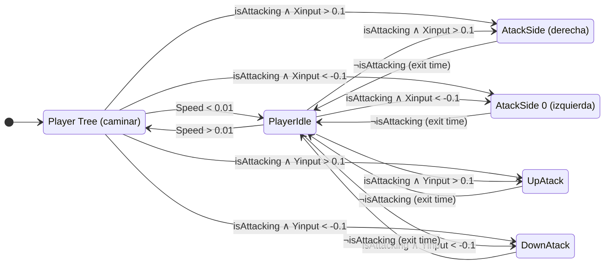
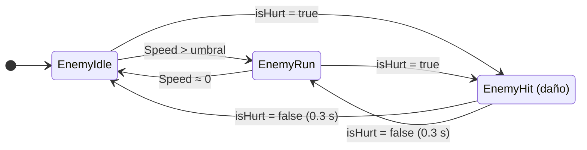
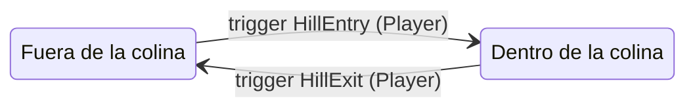
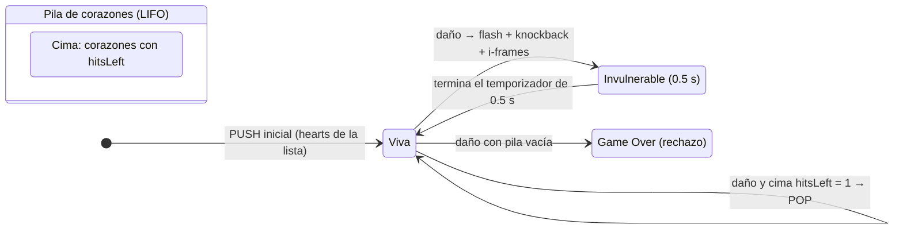
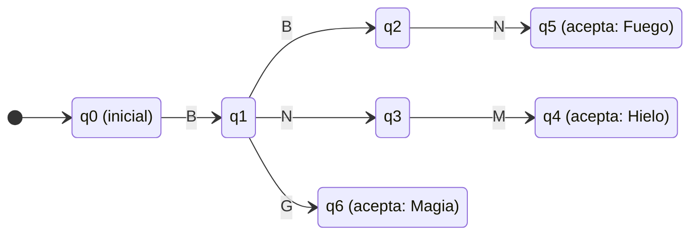

# Proyecto_lenguajes

Videojuego **2D top-down tipo dungeon/Zelda**, con estética **pixel art**, desarrollado en **Unity 6** como proyecto del curso de **Lenguajes de Programación** de la **Unillanos** (Universidad de los Llanos).

El objetivo académico del proyecto es aplicar teoría de **lenguajes formales y autómatas**: el comportamiento del jugador, del enemigo, del mapa y del sistema de vida se modela mediante autómatas (AFD y PDA) que se documentan en este README, indicando en cada caso el archivo de código donde vive el concepto.

---

## Descripción del juego

El jugador se mueve en 8 direcciones por un mundo construido con Tilemaps (pasto y colinas), con animaciones direccionales de caminar, idle y ataque. Hay un enemigo (hongo) que patrulla, persigue su ruta, daña al jugador por contacto y recibe daño de la espada del jugador con retroceso. La vida del jugador se modela como una **pila de corazones** de distintos colores, visualizada en la UI.

Funcionalidades implementadas:

- Movimiento del jugador con `Rigidbody2D` (8 direcciones).
- Animaciones direccionales: caminar e idle en 4 direcciones, ataque en 4 direcciones.
- Sistema de ataque por clic izquierdo con cooldown, congelamiento de movimiento durante el ataque y golpe con la espada.
- Enemigo con patrulla A/B, animaciones (idle, correr, daño), daño por contacto con cooldown, giro de rumbo al golpear y knockback al recibir daño.
- Sistema de vida como autómata de pila (PDA): corazones Amarillo (3 golpes), Azul (2) y Rojo (1), con UI en pantalla y pickups en el mapa (teñidos según su tipo).
- Efectos de combate: flash rojo y retroceso al recibir daño (jugador), retroceso del enemigo al ser golpeado.
- Zonas de colina con colisiones y orden de renderizado dinámicos.
- Profundidad top-down por sort del eje Y: árboles y rocas cubren al jugador cuando está detrás de ellos.
- Sistema de magia por combos: secuencias de teclas validadas por una **gramática regular** (sección 6); cada cadena aceptada lanza un proyectil distinto (fuego, hielo o magia) animado, que vuela hacia la dirección de mira, gira según el trayecto, daña al enemigo y muere contra los muros sólidos.

## Cómo correrlo

1. Instalar **Unity 6.3 LTS**, versión exacta **6000.3.28f1** (recomendado vía Unity Hub).
2. Clonar o descargar este repositorio (los sprites usan **Git LFS**).
3. En Unity Hub: **Add project from disk** y seleccionar la carpeta raíz del repositorio.
4. Abrir la escena `Assets/Scenes/SampleScene.unity`.
5. Presionar **Play**.

### Controles

| Acción | Entrada |
|--------|---------|
| Mover | Teclas de flechas / ejes `Horizontal` y `Vertical` de Input |
| Atacar | Clic izquierdo del mouse |
| Recoger corazón | Caminar sobre el pickup |
| Combo **Fuego** | `B`, `B`, `N` (teclear rápido: menos de 0.4 s entre teclas) |
| Combo **Hielo** | `B`, `N`, `M` |
| Combo **Magia** | `B`, `G` |

> Los combos usan letras del alfabeto, que no mueven al jugador: se puede mantener la dirección de mira mientras se teclea la secuencia. El proyectil sale hacia donde el jugador mira (`Xinput`/`Yinput`).

---

## Autómatas del proyecto

Esta sección es la **columna vertebral académica** del proyecto: cada autómata indica qué modela, en qué archivo del código está implementado y de qué tipo formal es.

### 1. FSM del Animator del jugador

**Qué modela:** todo el comportamiento visual del jugador — caminar, quedar en idle y atacar, en cada una de las 4 direcciones.

**Fuente:** `Assets/Animations/Player.controller` (Animator Controller) + scripts `PlayerMovement.cs` y `PlayerAttack.cs`.

**Tipo:** autómata finito determinista (AFD) con condiciones numéricas de guarda. Tiene salidas tanto en los **estados** (cada estado reproduce una animación) como en las **transiciones** (al atacar se congela la velocidad del jugador), lo que lo hace un híbrido entre una máquina de Moore y una de Mealy.

#### Alfabeto de entrada (parámetros del Animator)

| Parámetro | Tipo | Escribe | Significado |
|-----------|------|---------|-------------|
| `Xinput` | float | `PlayerMovement.cs` | Componente X de la última dirección de movimiento (-1 a 1) |
| `Yinput` | float | `PlayerMovement.cs` | Componente Y de la última dirección de movimiento (-1 a 1) |
| `Speed` | float | `PlayerMovement.cs` | Magnitud del movimiento actual |
| `isAttacking` | bool | `PlayerAttack.cs` (true con clic) y `ResetAttack()` vía Animation Event (false al terminar el clip) | Indica que el jugador está atacando |

> Nota: `Xinput`/`Yinput` solo se actualizan **cuando el jugador se mueve**. Al detenerse conservan la última dirección, lo que permite saber en qué dirección atacar aunque el jugador esté quieto.

#### Estados

| Estado | Clip(s) reproducido(s) | Rol |
|--------|------------------------|-----|
| `Player Tree` | BlendTree 2D: `SideWalk` (x=1), `UpWalk` (y=1), `SideWalk` (x=-1), `DownWalk` (y=-1) | Caminar en 4 direcciones |
| `PlayerIdle` | BlendTree 2D: `SideIdle` (x=±1), `Idle` (abajo, y=-1), `UpIdle` (arriba, y=1) | Idle en 4 direcciones |
| `AtackSide` | `AtackSide.anim` | Ataque hacia la derecha |
| `AtackSide 0` | `AtackSide.anim` (mismo clip) | Ataque hacia la izquierda |
| `UpAtack` | `UpAtack.anim` | Ataque hacia arriba |
| `DownAtack` | `DownAtack.anim` | Ataque hacia abajo |

- **Estado inicial:** `Player Tree`.
- El flip izquierda/derecha lo resuelve el **código** (`spriteRenderer.flipX` en `PlayerMovement.cs`), por eso los clips laterales se comparten entre izquierda y derecha.

#### Tabla de transiciones

Desde `Player Tree`:

| Condición de guarda | Estado destino |
|---------------------|----------------|
| `Speed < 0.01` | `PlayerIdle` |
| `isAttacking == true` ∧ `Xinput > 0.1` | `AtackSide` |
| `isAttacking == true` ∧ `Xinput < -0.1` | `AtackSide 0` |
| `isAttacking == true` ∧ `Yinput > 0.1` | `UpAtack` |
| `isAttacking == true` ∧ `Yinput < -0.1` | `DownAtack` |

Desde `PlayerIdle`:

| Condición de guarda | Estado destino |
|---------------------|----------------|
| `Speed > 0.01` | `Player Tree` |
| `isAttacking == true` ∧ `Yinput > 0.1` | `UpAtack` |
| `isAttacking == true` ∧ `Xinput > 0.1` | `AtackSide` |
| `isAttacking == true` ∧ `Yinput < -0.1` | `DownAtack` |
| `isAttacking == true` ∧ `Xinput < -0.1` | `AtackSide 0` |

Desde cada estado de ataque (`AtackSide`, `AtackSide 0`, `UpAtack`, `DownAtack`):

| Condición de guarda | Estado destino |
|---------------------|----------------|
| `isAttacking == false` (con exit time 0.423 y duración de transición 0.25 s) | `PlayerIdle` |

#### Diagrama de estados



#### El blend tree como generalización del autómata

Los estados `Player Tree` y `PlayerIdle` no son estados con un único clip, sino **blend trees 2D** sobre el par de entradas continuas `(Xinput, Yinput)`. El plano ℝ² queda particionado en regiones de influencia (derecha, izquierda, arriba, abajo) y el autómata "transiciona" de forma suave entre ellas según la dirección. Es la versión continua del AFD clásico: en vez de un símbolo discreto, la entrada es un vector real.

#### Ciclo de vida del ataque (coordinación código ↔ FSM)

1. El jugador hace clic: `PlayerAttack.cs` pone `isAttacking = true` y congela `rb.linearVelocity` (con cooldown de 0.3 s).
2. La FSM toma la dirección de `Xinput`/`Yinput` y entra al estado de ataque correspondiente.
3. Al terminar el clip, una **Animation Event** llama a `ResetAttack()`, que pone `isAttacking = false`.
4. La FSM regresa a `PlayerIdle`.

---

### 2. FSM del Animator del enemigo

**Qué modela:** el comportamiento visual del hongo — quedarse quieto, correr por su patrulla y mostrar el golpe recibido.

**Fuente:** `Assets/Animations/Enemy.controller` (referenciado desde la escena) + scripts `EnemyPatrol.cs` y `EnemyHealth.cs`.

**Tipo:** AFD con guardas numéricas y booleanas. Igual que el del jugador, produce salida en los estados (la animación) y la alimentan otros scripts del juego, por lo que es un autómata "receptivo": sus entradas no vienen del teclado sino del resto del sistema.

#### Alfabeto de entrada (parámetros del Animator)

| Parámetro | Tipo | Escribe | Significado |
|-----------|------|---------|-------------|
| `Speed` | float | `EnemyPatrol.cs` | Magnitud de la velocidad actual (0 = quieto, > 0 = patrullando) |
| `isHurt` | bool | `EnemyHealth.cs` | true durante 0.3 s cuando recibe daño (coroutina `HurtRoutine()`) |

#### Estados

| Estado | Clip | Rol |
|--------|------|-----|
| `EnemyIdle` | `EnemyIdle.anim` | El hongo está quieto (Speed ≈ 0) |
| `EnemyRun` | `EnemyRun.anim` | El hongo camina entre sus puntos de patrulla |
| `EnemyHit` | `EnemyHit.anim` | El hongo muestra su animación de daño (isHurt = true) |

- **Estado inicial:** `EnemyIdle`.

#### Tabla de transiciones

| Estado actual | Condición de guarda | Estado destino |
|---------------|---------------------|----------------|
| `EnemyIdle` | `Speed > umbral` | `EnemyRun` |
| `EnemyRun` | `Speed ≈ 0` | `EnemyIdle` |
| `EnemyIdle` o `EnemyRun` | `isHurt == true` | `EnemyHit` |
| `EnemyHit` | `isHurt == false` (tras `hurtDuration` = 0.3 s) | Estado anterior |

#### Diagrama de estados



#### Dónde vive cada parte del autómata

- **La lógica de movimiento que alimenta `Speed`** está en `EnemyPatrol.cs` (`FixedUpdate`), que además gestiona el flip del sprite y el intercambio de punto A/B.
- **La guarda temporal `isHurt`** la administra `EnemyHealth.cs` con una coroutina de 0.3 s, lo que convierte a `EnemyHit` en un estado con salida temporizada (un temporizador dentro del estado, como en un autómata temporizado).

---

### 3. FSM de las zonas del mapa (colinas)

**Qué modela:** el cambio de reglas del mundo cuando el jugador entra o sale de una colina — qué colisiones están activas y en qué capa de renderizado se dibuja el jugador.

**Fuente:** `Assets/Scripts/HillEntry.cs` y `Assets/Scripts/HillExit.cs`.

**Tipo:** AFD dirigido por eventos físicos (`OnTriggerEnter2D`). No hay estados codificados explícitamente; los estados son las dos configuraciones del mundo que el código mantiene, y las transiciones son los disparadores del tilemap.

#### Alfabeto de entrada

| Evento | Disparado por | Efecto |
|--------|--------------|--------|
| `OnTriggerEnter2D` en la zona de **entrada** a la colina | Tag `Player` | Transición Fuera → Dentro |
| `OnTriggerEnter2D` en la zona de **salida** de la colina | Tag `Player` | Transición Dentro → Fuera |

#### Estados y sus salidas

| Estado | Colliders de colina | Colliders de límites | `sortingOrder` del jugador |
|--------|--------------------:|---------------------:|---------------------------:|
| **Fuera de la colina** | Activados | Desactivados | 4 (orden base) |
| **Dentro de la colina** | Desactivados | Activados | 15 |

#### Tabla de transiciones

| Estado actual | Entrada | Estado siguiente | Acciones |
|---------------|---------|------------------|----------|
| Fuera | Cruza el trigger `HillEntry` | Dentro | Desactiva colliders de colina, activa límites, `sortingOrder = 15` |
| Dentro | Cruza el trigger `HillExit` | Fuera | Activa colliders de colina, desactiva límites, `sortingOrder = 4` |

**Estado inicial:** Fuera de la colina (configuración por defecto de la escena).

#### Diagrama de estados



Con esta FSM el jugador puede caminar *sobre* la colina sin chocar con ella (los colliders de la colina se desactivan), pero queda contenido dentro del área por los límites, y se dibuja por encima del terreno gracias al `sortingOrder`.

#### La profundidad por Y: del orden discreto al continuo

Al bajar de la colina, el jugador debe volver a respetar la profundidad del mundo top-down: un árbol lo cubre si está detrás de él y lo deja ver si está delante. Resolverlo a mano con `sortingOrder` fijo falló en la práctica: el jugador regresaba con un orden por encima de los árboles y los "atravesaba" visualmente.

La solución fue mover ese orden a una **entrada continua**: el proyecto usa el sort por transparencia con eje personalizado `(0, 1, 0)` (`ProjectSettings/GraphicsSettings.asset`, `TransparencySortMode: CustomAxis`), de modo que dos objetos con el mismo `sortingOrder` se ordenan por su posición Y — lo que está más abajo en pantalla se dibuja delante. Además, los Tilemaps de árboles usan **Modo de render = Individual** para que cada tile de árbol se ordene por separado contra el jugador.

| Regla de profundidad | Cómo se decide |
|----------------------|----------------|
| Jugador vs árboles | Ambos en `sortingOrder` 4; decide la **Y continua** (posición en pantalla) |
| Jugador sobre la colina | `sortingOrder` 15, por encima de todo (el estado "Dentro" de la FSM) |
| Tilemaps de fondo | Órdenes fijos más bajos (el orden discreto domina sobre el eje Y) |

Académicamente es la misma lección del blend tree aplicada al eje de profundidad: donde el AFD discreto (`sortingOrder` fijo por estado) era insuficiente, la generalización continua (Y como entrada real) resuelve el problema de forma natural.

---

### 4. El sistema de vida como autómata de pila (PDA)

Este es el autómata más ambicioso del proyecto hasta ahora: la **vida del jugador no es una barra ni un número**, es un **autómata de pila (pushdown automaton, PDA)** completo.

**Qué modela:** la resistencia del jugador como una pila LIFO de corazones, donde cada corazón es un símbolo con su propia "resistencia".

**Fuente:** `Assets/Scripts/PlayerHealth.cs` (el autómata), `Assets/Scripts/HeartPickup.cs` (entrada PUSH desde el mundo) y `Assets/Scripts/HealthUI.cs` (visualización de la pila).

**Tipo:** autómata de pila (PDA) determinista en la práctica: en cada momento la cima de la pila determina de forma única qué ocurre con el siguiente golpe o pickup.

#### Alfabeto de entrada

| Símbolo de entrada | Origen en el código | Efecto sobre la pila |
|--------------------|---------------------|----------------------|
| `daño` | `PlayerHealth.TakeDamage(damage, hitDirection)`, llamado por `EnemyContactDamage.cs` | Resta 1 golpe al corazón de la **cima**; si sus golpes llegan a 0, la cima sale de la pila (POP) |
| `recoger(color)` | `PlayerHealth.PushHeart(type)`, llamado por `HeartPickup.cs` al tocar el pickup | Apila un corazón nuevo del color dado (PUSH); si la pila está llena, la entrada se **rechaza** y el pickup permanece en el mapa |

#### Los símbolos de la pila (alfabeto de pila)

Cada corazón es un objeto `Heart` con un tipo `HeartColor`. El tipo define cuántos golpes absorbe antes de romperse:

| Símbolo (color) | Golpes que absorbe | Color de tinte en la UI |
|-----------------|--------------------|-------------------------|
| `Amarillo` | 3 | Amarillo `(1, 0.92, 0.23)` |
| `Azul` | 2 | Azul `(0.2, 0.55, 1)` |
| `Rojo` | 1 | Rojo `(0.95, 0.25, 0.25)` |

Cada `Heart` guarda además `hitsLeft`, el "desgaste" actual del símbolo en la cima.

#### Estados de control

El PDA tiene tres configuraciones globales:

| Estado | Condición | Salida |
|--------|-----------|--------|
| **Viva** | `hearts.Count > 0` | La UI dibuja la pila (ver abajo) |
| **Vulnerable** | Viva ∧ `invulnerabilityTimer == 0` | Puede recibir `daño` |
| **Invulnerable** | Viva ∧ `invulnerabilityTimer > 0` | Ignora `daño` (ventana de 0.5 s con parpadeo) |
| **Rechazo (Game Over)** | `hearts.Count == 0` | La cadena de entrada no fue aceptada: el jugador muere |

#### Reglas de transición de la pila

| Estado de la pila | Entrada | Acción (transición) |
|-------------------|---------|---------------------|
| No llena (`Count < maxHearts`) | `recoger(color)` | PUSH: nuevo `Heart(color)` en la cima |
| Llena (`Count == maxHearts`) | `recoger(color)` | **Rechaza** la entrada: no hay PUSH y el pickup no se consume |
| Cima con `hitsLeft > 1` | `daño` | `hits--` sobre la cima (la pila no cambia de tamaño) |
| Cima con `hitsLeft == 1` | `daño` | POP: la cima sale de la pila |
| Vacía | `daño` | Estado de rechazo → **Game Over** |
| Invulnerable (temporizador > 0) | `daño` | La entrada se ignora (0.5 s) |

#### Diagrama



#### La UI como espejo de la pila

`HealthUI.Refresh(Stack<Heart>)` en `Assets/Scripts/HealthUI.cs` recorre la pila de la **cima hacia abajo** y dibuja un icono por corazón dentro de un `Horizontal Layout Group`:

- El **primer icono (izquierda) es la cima**: el corazón que recibe el daño primero.
- El icono se **tinta** con el color del tipo (`Image.color` sobre un sprite base gris, `Assets/Sprites/Heart 1.png`), con iconos de 80×80 en pantalla.
- El icono se **oscurece** proporcionalmente a los golpes perdidos (`Color.Lerp` hacia negro según `hitsLeft`).

Es decir, la UI es una función pura de la pila: `pantalla = dibujar(pila)`. No guarda estado propio; se redibuja completa en cada transición (`NotifyUI()`).

Los **pickups del mapa** también visten el color de su tipo: `HeartPickup.cs` tinta su `SpriteRenderer` en `Start()` con la misma paleta de la UI, así el corazón del mundo se ve idéntico al icono que aparecerá al recogerlo. (El tinte es multiplicativo, por eso el sprite base tiene relleno gris claro.)

#### Dónde vive cada parte del PDA

| Concepto formal | Implementación |
|-----------------|----------------|
| Alfabeto de entrada | Métodos `TakeDamage()` y `PushHeart()` (las dos únicas "letras" que el autómata lee) |
| Alfabeto de pila | Enum `HeartColor` (Amarillo=3, Azul=2, Rojo=1) y clase `Heart` |
| La pila | `Stack<Heart> hearts` en `PlayerHealth.cs` |
| Función de transición | El `for` dentro de `TakeDamage()` y las guardas de `PushHeart()` |
| Estado de rechazo | `hearts.Count == 0` → "Game Over" |
| Estado invulnerable con temporizador | `invulnerabilityTimer` (0.5 s de parpadeo) |

---

### 5. Guardas temporales (relojes dentro de los autómatas)

Varias transiciones de los autómatas anteriores no dependen solo de la entrada, sino también del **tiempo transcurrido**. Conceptualmente son autómatas temporizados: cada temporizador es una guarda que debe satisfacerse para que la transición ocurra.

| Temporizador | Valor | Dónde está | Qué guarda |
|--------------|-------|------------|------------|
| Cooldown de ataque del jugador | 0.3 s | `PlayerAttack.cs` (`attackCooldown`) | No puede iniciarse un nuevo ataque antes de 0.3 s |
| Duración del ataque | 0.4 s | `PlayerAttack.cs` (`attackDuration`) | Respaldo del Animation Event que termina el ataque |
| Cooldown de golpe conectado | 0.5 s | `PlayerSword.cs` (`hitCooldown`) | Dos ataques seguidos no cuentan como doble golpe al enemigo |
| Cooldown de ataque del enemigo | 1.0 s | `EnemyContactDamage.cs` (`attackCooldown`) | Un contacto prolongado no drena la pila: 1 golpe por segundo como máximo |
| Invulnerabilidad del jugador | 0.5 s | `PlayerHealth.cs` (`invulnerabilityTime`) | Tras recibir daño, ignora nuevos golpes y parpadea |
| Flash de daño | 0.15 s | `PlayerHealth.cs` (`flashDuration`) | Duración del tinte rojo fuerte al recibir el golpe |
| Duración del "hurt" del enemigo | 0.3 s | `EnemyHealth.cs` (`hurtDuration`) | Cuánto tiempo permanece la guarda `isHurt == true` |
| Duración del knockback (jugador) | 0.2 s | `PlayerHealth.cs` (`knockbackDuration`) | Tiempo sin control del movimiento mientras actúa el retroceso |
| Duración del knockback (enemigo) | 0.15 s | `PlayerSword.cs` (`enemyKnockbackDuration`) | Tiempo sin patrulla mientras actúa el retroceso del enemigo |
| Timeout de la gramática de combos | 0.4 s | `ComboController.cs` (`timeout`) | Sin teclas durante 0.4 s, la cadena a medias se cancela y el autómata vuelve al estado inicial |

Estas guardas resuelven un problema clásico de modelado: los eventos físicos de Unity (`OnCollisionStay2D`, `OnTriggerStay2D`) ocurren **cada frame**, pero las transiciones del autómata deben ser discretas. Los temporizadores convierten un flujo continuo de eventos en símbolos discretos del alfabeto.

---

### 6. La gramática regular de los combos (tipo 3 de Chomsky)

Este sistema es la aplicación más directa del curso: el **lenguaje de los combos está definido por una gramática regular** (lineal por la derecha, tipo 3 de Chomsky), y el reconocedor que corre en runtime **se compila automáticamente desde esa gramática**.

**Qué modela:** qué secuencias de teclas son combos válidos y qué proyectil produce cada una.

**Fuente:** `Assets/Scripts/ComboController.cs` (la gramática y su compilación) + `Assets/Scripts/Projectile.cs` (la salida).

**Tipo:** gramática regular (tipo 3) **compilada** a un autómata finito determinista (AFD) en forma de trie. Por el teorema de Kleene, gramáticas regulares y autómatas finitos son equivalentes: la gramática *genera* el lenguaje (punto de vista declarativo, visible en el Inspector) y el autómata lo *reconoce* (punto de vista operativo, lo que corre en el juego).

#### Alfabeto

El alfabeto lógico es el conjunto de teclas que `LeerSimbolo()` reconoce: **flechas, WASD y las letras A-Z**. Cada tecla presionada es un símbolo de entrada; las flechas y WASD se normalizan a los símbolos de flecha (ambas formas producen el mismo símbolo lógico).

Las producciones usan letras (`B`, `N`, `M`, `G`) por una ventaja práctica: **no mueven al jugador**, así que se puede mantener la dirección de mira mientras se teclea el combo.

#### Producciones de la gramática (serializadas en el Inspector)

| Producción | Cadena | Estado de aceptación produce (salida Mealy) | Daño |
|------------|--------|---------------------------------------------|------|
| `Fuego` | `B B N` | Proyectil `Fireball` | 1 |
| `Hielo` | `B N M` | Proyectil `Iceball` | 1 |
| `Magia` | `B G` | Proyectil `Magicball` | 1 |

#### Compilación: gramática → AFD

En `Awake()`, `CompilarGramatica()` convierte la lista de producciones en un **trie determinista**: para cada cadena, recorre (o crea) el camino de estados correspondiente a sus prefijos, y marca el estado final con la regla completa (estado de **aceptación**). Cada nodo tiene una tabla de transiciones `Dictionary<KeyCode, Nodo>` — una función de transición δ determinista.



Los tres estados de aceptación (`q5`, `q4`, `q6`) son **estados de aceptación con salida**: al entrar en ellos se lanza el proyectil asociado y el autómata vuelve al estado inicial (la cadena se consumió completa). Como la salida se produce en la transición de aceptación y no en el estado mismo, es un comportamiento tipo **Mealy**.

#### Funcionamiento del reconocedor (Update)

| Entrada | Comportamiento |
|---------|----------------|
| Símbolo con transición válida | Avanza al estado siguiente |
| Símbolo no esperado | Cadena **rechazada**: vuelve al estado inicial y reintenta ese mismo símbolo desde ahí |
| Estado de aceptación | Lanza el proyectil (salida) y reinicia al estado inicial |
| 0.4 s sin teclas | Guarda temporal: la cadena a medias se cancela (vuelta al estado inicial) |

Fíjate que los tres combos **comparten el prefijo `B`**: en el autómata, la segunda tecla decide la rama (`B` → fuego, `N` → hielo, `G` → magia). El trie maneja prefijos compartidos sin ambigüedad.

#### Restricción de diseño: ninguna producción prefijo de otra

El autómata acepta y reinicia **en cuanto** llega a un estado de aceptación, así que si una producción fuera prefijo de otra (p. ej. `Magia = B N` con `Hielo = B N M`), la corta "se tragaría" a la larga: al teclear `B N` se lanzaría Magia y se reiniciaría el autómata, dejando la `M` de Hielo sin contexto — Hielo se volvería inalcanzable. La gramática seguiría siendo regular, pero el lenguaje efectivo perdería la cadena larga.

Regla práctica: dos combos pueden compartir el inicio, pero cuando se bifurcan, se bifurcan para siempre. (La alternativa académica — diferir la aceptación con un buffer, como el *maximal munch* de los lexer — se descartó por introducir retraso perceptible en la salida.)

#### El proyectil: la salida del autómata en el mundo

`Projectile.cs` materializa la aceptación de la gramática:

1. `Lanzar(dirección, daño)`: recibe la dirección de mira del jugador y fija la velocidad; el sprite (que apunta a la derecha) **rota** hacia la dirección de vuelo con `Atan2`.
2. Ignora al `Player` y a los **triggers "fantasma"** (espada, pickups, zonas de colina): solo colisiones no-trigger (muros) lo destruyen.
3. Si toca un `EnemyHealth`, le aplica el daño del combo y muere; además tiene guarda temporal propia (`vidaMaxima` = 2 s).

#### Dónde vive cada parte de la gramática

| Concepto formal | Implementación |
|-----------------|----------------|
| Alfabeto | `LeerSimbolo()` en `ComboController.cs` (flechas + WASD + letras A-Z) |
| Producciones | Lista serializada `combos` en el Inspector (nombre, secuencia, proyectil, daño) |
| Compilación gramática → AFD | `CompilarGramatica()` en `Awake()` (trie determinista) |
| Función de transición δ | `transiciones` (Dictionary) de cada nodo |
| Estados de aceptación | Campo `acepta` de cada nodo (la regla completa) |
| Salida (Mealy) | `LanzarProyectil()` en la transición de aceptación |
| Guarda temporal | `timeout` = 0.4 s en `Update()` |

---

## Combate bidireccional (cómo interactúan los autómatas)

Los autómatas de las secciones anteriores no viven aislados: se comunican. Este es el flujo completo de un intercambio de golpes:

**El jugador golpea al enemigo:**

1. Clic → `PlayerAttack.cs` activa `isAttacking` (FSM del jugador, sección 1) y congela el movimiento.
2. `PlayerSword.cs` (en el hijo `SwordTrigger`) coloca el trigger delante del jugador según `Xinput`/`Yinput`.
3. Si el trigger toca un objeto con tag `Enemy` → `EnemyHealth.TakeDamage()` → guarda `isHurt` 0.3 s (FSM del enemigo, sección 2) + knockback vía `EnemyPatrol.ApplyKnockback()`.
4. Al terminar el clip, Animation Event → `ResetAttack()` → regreso a idle.

**El enemigo golpea al jugador:**

1. Contacto físico → `EnemyContactDamage.cs`: en `OnCollisionEnter2D` llama `EnemyPatrol.TurnAround()` (el hongo da media vuelta y se retira) y en `OnCollisionStay2D` aplica daño si su cooldown de 1 s lo permite.
2. `PlayerHealth.TakeDamage()` consume golpes de la cima de la pila (PDA, sección 4), aplica flash rojo (0.15 s), knockback (0.2 s) e invulnerabilidad (0.5 s).
3. `PlayerMovement.cs` consulta `IsKnockedBack` para no pelear con el retroceso (y `animator.GetBool("isAttacking")` para no caminar durante el ataque).

**El jugador lanza un proyectil (gramática de combos, sección 6):**

1. El jugador teclea una cadena válida (p. ej. `B B N`) → la gramática compilada en `ComboController.cs` llega a un estado de aceptación y lanza el proyectil del combo.
2. `Projectile.cs` toma la dirección de mira (`Xinput`/`Yinput`), rota el sprite hacia esa dirección y vuela en línea recta.
3. Si toca al enemigo → `EnemyHealth.TakeDamage()` (FSM del enemigo, sección 2) + knockback; si toca un muro sólido, muere; los triggers "fantasma" no lo detienen.

El knockback en ambos sentidos existe para que la "coreografía" del duelo sea legible: cada golpe separa físicamente a los combatientes y devuelve el control a los autómatas de movimiento tras su ventana temporizada.

---

## Reutilización entre niveles

El proyecto está preparado para construir niveles nuevos con el mínimo trabajo manual. Dos mecanismos lo permiten:

### Auto-configuración en el código

Los scripts detectan si falta configuración en el Inspector y se auto-completan con **convenciones de nombres**:

| Script | Si el Inspector está vacío... | Convención requerida |
|--------|------------------------------|----------------------|
| `EnemyPatrol.cs` | Crea sus puntos de patrulla alrededor del punto inicial (a `patrolDistance` a cada lado, en el eje X) | Ninguna: funciona solo |
| `HillEntry.cs` / `HillExit.cs` | Busca los tilemaps por nombre y cablea sus colliders | Tilemap de acantilados llamado `HillsCollition` y tilemap de límites llamado `HillBoundary` |

Si algo se asigna a mano, el código lo respeta (compatibilidad con la escena actual). En niveles con **varias colinas**, renombra los tilemaps (p. ej. `HillsCollition2`) y cablea a mano.

### Receta para armar un nivel nuevo

1. Duplicar la escena actual (`Ctrl+D` sobre `SampleScene` en el Project) o crear una escena vacía y montar el Grid.
2. Pintar los Tilemaps respetando nombres y sorting orders:

| Tilemap | Nombre | Sorting Order | Render Mode |
|---------|--------|--------------:|-------------|
| Suelo/pasto | libre | 0 | Group |
| Agua | libre | 0 | Group |
| Acantilados con colisión | `HillsCollition` | 5 | Group |
| Muros invisibles del borde de colina | `HillBoundary` | 0 | Group |
| Árboles con colisión | libre | 4 | **Individual** |
| Árboles decorativos | libre | 4 | **Individual** |

3. Arrastrar los prefabs a la escena: `Player`, `HealthCanvas` y `Enemy` (cada uno ya trae sus componentes, tags y referencias internas).
4. Colocar pickups `HeartPickup` (cambiar `Type` por instancia si se quiere otro color) y los triggers `Entry`/`Exit` de la colina.
5. Verificar en el Inspector: `Entry` y `Exit` con las listas de colliders **vacías** (se auto-cablean al Play).

### Prefabs pendientes de crear (una sola vez)

En el editor de Unity, arrastrar a `Assets/Prefabs`:
- **Player** (con su hijo `SwordTrigger`): trae movimiento, ataque, vida PDA y el tag `Player` correcto.
- **HealthCanvas** (con su hijo `Hearts`): trae el script `HealthUI` con sus referencias ya conectadas.
- **Enemy**: tras el cambio de auto-puntos, queda 100% auto-contenido.

---

## Pendiente / planeado

> **Nota:** lo que sigue **no está implementado** todavía; es el diseño previsto para las próximas iteraciones del proyecto.

- **Autómata finito para los mapas:** FSM que modele el cambio completo de escena/zona al transitar entre mapas (más allá de las colinas actuales).
- **Autómata de pila (PDA) para los mapas:** estructura con memoria de contexto para manejar jerarquías de zonas (p. ej., mundo → dungeon → sala), donde regresar implica desapilar el mapa anterior.
- **Game Over visual:** hoy el rechazo del PDA destruye al jugador con un log en Console; falta pantalla de muerte/respawn.

---

## Relación con el curso (lenguajes formales y autómatas)

| Elemento del proyecto | Concepto del curso que ilustra | Dónde se usa |
|-----------------------|-------------------------------|--------------|
| FSM del Animator del jugador | **Autómata finito determinista (AFD)**: estados, alfabeto de entrada, función de transición por guardas y estado inicial definido. Es además un **híbrido Moore/Mealy**: cada estado produce salida (la animación) y algunas transiciones también tienen acciones (congelar velocidad). | `Assets/Animations/Player.controller`, `PlayerMovement.cs`, `PlayerAttack.cs` |
| Blend trees 2D | **Generalización continua del AFD**: la entrada no es un símbolo discreto sino un vector en ℝ²; el plano se particiona en regiones y la salida interpola entre clips. | Estados `Player Tree` y `PlayerIdle` del `Player.controller` |
| FSM del Animator del enemigo | **AFD receptivo**: sus entradas no son del jugador sino del resto del sistema (`Speed`, `isHurt`), con un estado temporizado (`EnemyHit`). | `Assets/Animations/Enemy.controller`, `EnemyPatrol.cs`, `EnemyHealth.cs` |
| FSM de zonas (colinas) | **AFD dirigido por eventos** (reconocimiento de eventos físicos del tilemap), con acciones asociadas a cada transición. | `HillEntry.cs`, `HillExit.cs` |
| Sort de profundidad por eje Y | **Generalización continua de la profundidad**: cuando el orden discreto (`sortingOrder` fijo) era insuficiente, la posición Y continua decide el orden de dibujo (Transparency Sort Mode Custom Axis + tilemaps en modo Individual). | `ProjectSettings/GraphicsSettings.asset`, Tilemap Renderers de árboles |
| Sistema de vida | **Autómata de pila (PDA)**: alfabeto de entrada (daño, recoger), alfabeto de pila (colores de corazón), PUSH/POP, estado de rechazo = Game Over. La UI es una función de la pila. | `PlayerHealth.cs`, `HeartPickup.cs`, `HealthUI.cs` |
| Guardas temporales | **Autómatas temporizados**: transiciones condicionadas por tiempo acumulado; convierten eventos continuos por frame en símbolos discretos. | Cooldowns en `PlayerAttack.cs`, `PlayerSword.cs`, `EnemyContactDamage.cs`, `PlayerHealth.cs` |
| Ciclo de ataque con Animation Event | Distinción entre **entrada de la FSM** (`isAttacking`) y **acciones de salida** (`ResetAttack()` como evento generado por la animación), y el papel de las **guardas temporales** (cooldown, exit time). | `PlayerAttack.cs` + clips de ataque |
| Combos de teclas | **Gramática regular (tipo 3 de Chomsky) compilada a AFD**: las producciones se serializan como datos en el Inspector y se compilan a un trie determinista en `Awake()` (teorema de Kleene: gramática regular ↔ autómata finito). Los estados de aceptación producen salida al transitar (comportamiento **Mealy**: lanzar el proyectil). Alfabeto extendido (flechas, WASD, letras A-Z) y guarda temporal de 0.4 s. | `ComboController.cs`, `Projectile.cs` |
| Autómatas de mapas (planeado) | AFD para navegación entre zonas y **autómata de pila (PDA)** para la jerarquía de mapas (apilar/desapilar el contexto de ubicación). | Pendiente |

---

## Estructura del proyecto

```
Proyecto_lenguajes/
├── Assets/
│   ├── Animations/          # Clips .anim + Player.controller y Enemy.controller (las FSM)
│   ├── Scenes/              # SampleScene.unity (escena principal)
│   ├── Scripts/             # Código C#
│   │   ├── PlayerMovement.cs        # Movimiento; congela animación y velocidad al atacar o recibir knockback
│   │   ├── PlayerAttack.cs          # isAttacking + cooldown 0.3 s + duración 0.4 s
│   │   ├── PlayerSword.cs           # Hitbox de la espada; hitCooldown 0.5 s; knockback al enemigo
│   │   ├── PlayerHealth.cs          # PDA de la vida: Stack<Heart>, PUSH/POP, flash, knockback, i-frames
│   │   ├── HealthUI.cs              # Dibuja la pila de corazones (tinte + oscurecido por daño)
│   │   ├── HeartPickup.cs           # Trigger de recogida: PUSH a la pila (si no está llena)
│   │   ├── EnemyPatrol.cs           # Patrulla A/B; escribe Speed; TurnAround(); ApplyKnockback()
│   │   ├── EnemyHealth.cs           # Vida del enemigo; isHurt 0.3 s (coroutina)
│   │   ├── EnemyContactDamage.cs    # Daño por contacto; cooldown 1 s; TurnAround() al iniciar contacto
│   │   ├── HillEntry.cs             # Transición a "Dentro de la colina"
│   │   ├── HillExit.cs              # Transición a "Fuera de la colina"
│   │   ├── ComboController.cs       # Gramática regular de combos compilada a trie/AFD; lanza proyectiles
│   │   └── Projectile.cs            # Vuelo del proyectil, rotación hacia la dirección, impacto (daño/muros)
│   ├── Sprites/             # Pixel art (jugador, hongo, tiles, colinas, deco, agua, Heart 1.png, Fire/Ice/Magic.png)
│   ├── Prefabs/             # HeartIcon, HeartPickup, Player, HealthCanvas, Enemy, Fireball, Iceball, Magicball
│   └── Settings/            # Configuración URP y Input System
├── Packages/                # Dependencias (manifest.json)
└── ProjectSettings/         # Configuración del proyecto Unity
```

### Componentes de escena relevantes (configuración en el editor de Unity)

| Objeto | Componentes clave | Notas |
|--------|-------------------|-------|
| `Player` | `PlayerMovement`, `PlayerAttack`, `PlayerHealth`, `ComboController` | Tag obligatorio: `Player` (lo usan HillEntry/HillExit y HeartPickup). `Initial Hearts` se apila en orden: el último de la lista queda en la cima. `Combos` serializa las producciones de la gramática (sección 6) |
| `SwordTrigger` (hijo de Player) | Collider 2D (trigger) + `PlayerSword` | Se posiciona delante del jugador según `Xinput`/`Yinput` |
| `Enemy` | `EnemyPatrol`, `EnemyHealth`, `EnemyContactDamage` | Tag: `Enemy`. Requiere `pointA`/`pointB` asignados |
| `HealthCanvas` > `Hearts` | `HealthUI` + Horizontal Layout Group | El primer icono (izquierda) es la cima de la pila; iconos de 80×80 |
| `HeartPickup` | Sprite + Circle Collider 2D (Is Trigger) + `HeartPickup` | Campo `Type` define el color que hace PUSH; el script tinta el sprite según el tipo |
| Tilemaps `TreeCollition` / `TreeNotCollition` | Tilemap Collider 2D + Tilemap Renderer (Modo Individual, Order 4) | Mismo orden que el jugador: la profundidad la decide el sort por eje Y |
| `Fireball` / `Iceball` / `Magicball` (prefabs) | Animator (clip de vuelo en bucle, ciclo 0.25 s), Rigidbody 2D (Gravity 0), Circle Collider 2D (Is Trigger), `Projectile`, Order in Layer 5 | Salida de los estados de aceptación de la gramática; hojas de sprites de 5 frames (320×32, PPU 32) |

---

*Proyecto del curso de Lenguajes de Programación — Unillanos.*
