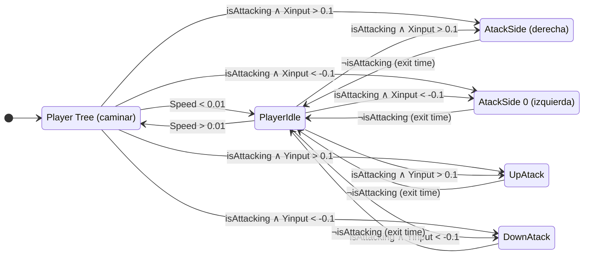
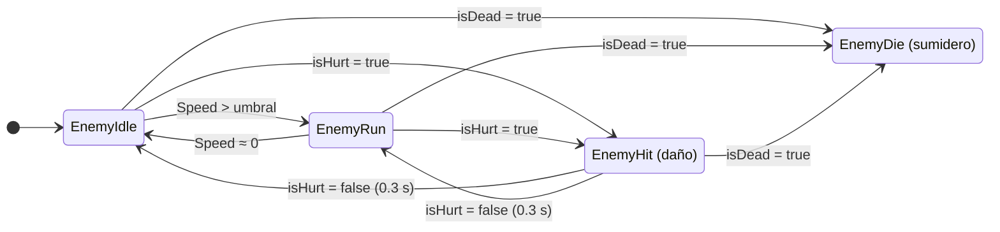
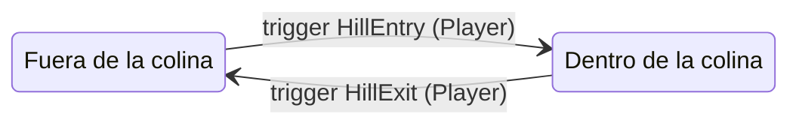
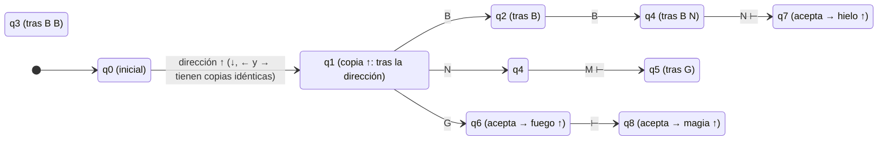
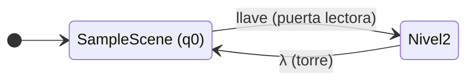
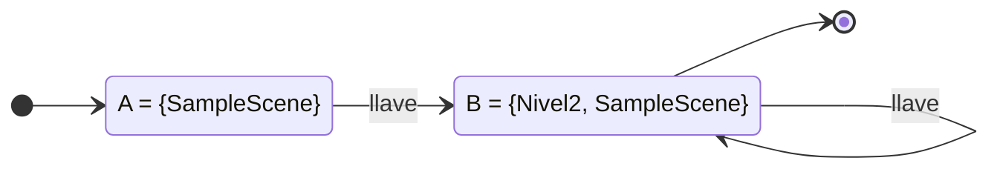

# Proyecto_lenguajes

**Autor:** Daniel Pinilla — curso *Lenguajes de Programación*, Unillanos (Universidad de los Llanos).

Videojuego **2D top-down tipo dungeon/Zelda**, con estética **pixel art**, desarrollado en **Unity 6** como proyecto del curso de **Lenguajes de Programación** de la **Unillanos** (Universidad de los Llanos).

El objetivo académico del proyecto es aplicar teoría de **lenguajes formales y autómatas**: el comportamiento del jugador, del enemigo, del mapa y del sistema de vida se modela mediante autómatas (AFD y PDA) que se documentan en este README, indicando en cada caso el archivo de código donde vive el concepto.

---

## Descripción del juego

El jugador se mueve en 8 direcciones por un mundo construido con Tilemaps (pasto y colinas), con animaciones direccionales de caminar, idle y ataque. Hay un enemigo (hongo) que patrulla, persigue su ruta, daña al jugador por contacto y recibe daño de la espada del jugador con retroceso. La vida del jugador se modela como una **pila de corazones** de distintos colores, visualizada en la UI.

Funcionalidades implementadas:

- Movimiento del jugador con `Rigidbody2D` (8 direcciones).
- Animaciones direccionales: caminar e idle en 4 direcciones, ataque en 4 direcciones.
- Sistema de ataque por clic izquierdo con cooldown, congelamiento de movimiento durante el ataque y golpe con la espada.
- Enemigos con dos tipos de patrulla: **ida y vuelta A/B** (`EnemyPatrol.cs`) y **ruta de 3 puntos de ida y vuelta** (`EnemyPatrol3Puntos.cs`, P1→P2→P3→P2→P1, ideal para rutas en L). Ambas implementan la interfaz `IEnemigoMovil`, el contrato que usan el knockback de la espada y la media vuelta por contacto. Animaciones (idle, correr, daño), daño por contacto con cooldown y knockback al recibir daño.
- Sistema de vida como autómata de pila (PDA): pila ilimitada de corazones Amarillo (3 golpes), Azul (2) y Rojo (1), arrancando en la configuración `(q0, Z0)` (un corazón rojo como símbolo inicial de pila), con UI en pantalla y pickups en el mapa (teñidos según su tipo).
- Efectos de combate: flash rojo y retroceso al recibir daño (jugador), retroceso del enemigo al ser golpeado.
- Zonas de colina con colisiones y orden de renderizado dinámicos.
- Profundidad top-down por sort del eje Y: árboles y rocas cubren al jugador cuando está detrás de ellos.
- Sistema de magia por combos: secuencias de teclas validadas por una **gramática de traducción** (sección 6); cada cadena aceptada — que trae su propia dirección y comando — lanza un proyectil distinto (fuego, hielo o magia) animado, que vuela hacia la dirección indicada como primer símbolo del combo, gira según el trayecto, daña al enemigo y muere contra los muros sólidos.

## Cómo correrlo

1. Instalar **Unity 6.3 LTS**, versión exacta **6000.3.28f1** (recomendado vía Unity Hub).
2. Clonar o descargar este repositorio (los sprites usan **Git LFS**).
3. En Unity Hub: **Add project from disk** y seleccionar la carpeta raíz del repositorio.
4. Abrir la escena `Assets/Scenes/SampleScene.unity`.
5. Presionar **Play**.

### Controles

| Acción | Entrada |
|--------|---------|
| Mover | Teclas de flechas / ejes `Horizontal` y `Vertical` de Input |
| Atacar | Clic izquierdo del mouse |
| Recoger corazón | Caminar sobre el pickup |
| Combo **Fuego** | `W`/`A`/`S`/`D` (dirección) + `B`, `B`, `N` + `Espacio` |
| Combo **Hielo** | dirección + `B`, `N`, `M` + `Espacio` |
| Combo **Magia** | dirección + `B`, `G` + `Espacio` |

> Toda cadena de combo tiene la forma **dirección · combo · `Espacio`**: el primer símbolo fija la dirección del proyectil (y viaja dentro de la cadena), y las letras del combo no mueven al jugador. El efecto es, así, función exclusiva de la cadena tecleada.

---

## Autómatas del proyecto

Esta sección es la **columna vertebral académica** del proyecto: cada autómata indica qué modela, en qué archivo del código está implementado y de qué tipo formal es.

### 1. FSM del Animator del jugador

**Qué modela:** todo el comportamiento visual del jugador — caminar, quedar en idle y atacar, en cada una de las 4 direcciones.

**Fuente:** `Assets/Animations/Player.controller` (Animator Controller) + scripts `PlayerMovement.cs` y `PlayerAttack.cs`.

**Tipo:** autómata finito determinista (AFD) con condiciones numéricas de guarda. Tiene salidas tanto en los **estados** (cada estado reproduce una animación) como en las **transiciones** (al atacar se congela la velocidad del jugador), lo que lo hace un híbrido entre una máquina de Moore y una de Mealy.

#### Alfabeto de entrada (parámetros del Animator)

| Parámetro | Tipo | Escribe | Significado |
|-----------|------|---------|-------------|
| `Xinput` | float | `PlayerMovement.cs` | Componente X de la última dirección de movimiento (-1 a 1) |
| `Yinput` | float | `PlayerMovement.cs` | Componente Y de la última dirección de movimiento (-1 a 1) |
| `Speed` | float | `PlayerMovement.cs` | Magnitud del movimiento actual |
| `isAttacking` | bool | `PlayerAttack.cs` (true con clic) y `ResetAttack()` vía Animation Event (false al terminar el clip) | Indica que el jugador está atacando |

> Nota: `Xinput`/`Yinput` solo se actualizan **cuando el jugador se mueve**. Al detenerse conservan la última dirección, lo que permite saber en qué dirección atacar aunque el jugador esté quieto.

#### Estados

| Estado | Clip(s) reproducido(s) | Rol |
|--------|------------------------|-----|
| `Player Tree` | BlendTree 2D: `SideWalk` (x=1), `UpWalk` (y=1), `SideWalk` (x=-1), `DownWalk` (y=-1) | Caminar en 4 direcciones |
| `PlayerIdle` | BlendTree 2D: `SideIdle` (x=±1), `Idle` (abajo, y=-1), `UpIdle` (arriba, y=1) | Idle en 4 direcciones |
| `AtackSide` | `AtackSide.anim` | Ataque hacia la derecha |
| `AtackSide 0` | `AtackSide.anim` (mismo clip) | Ataque hacia la izquierda |
| `UpAtack` | `UpAtack.anim` | Ataque hacia arriba |
| `DownAtack` | `DownAtack.anim` | Ataque hacia abajo |

- **Estado inicial:** `Player Tree`.
- El flip izquierda/derecha lo resuelve el **código** (`spriteRenderer.flipX` en `PlayerMovement.cs`), por eso los clips laterales se comparten entre izquierda y derecha.

#### Tabla de transiciones

Desde `Player Tree`:

| Condición de guarda | Estado destino |
|---------------------|----------------|
| `Speed < 0.01` | `PlayerIdle` |
| `isAttacking == true` ∧ `Xinput > 0.1` | `AtackSide` |
| `isAttacking == true` ∧ `Xinput < -0.1` | `AtackSide 0` |
| `isAttacking == true` ∧ `Yinput > 0.1` | `UpAtack` |
| `isAttacking == true` ∧ `Yinput < -0.1` | `DownAtack` |

Desde `PlayerIdle`:

| Condición de guarda | Estado destino |
|---------------------|----------------|
| `Speed > 0.01` | `Player Tree` |
| `isAttacking == true` ∧ `Yinput > 0.1` | `UpAtack` |
| `isAttacking == true` ∧ `Xinput > 0.1` | `AtackSide` |
| `isAttacking == true` ∧ `Yinput < -0.1` | `DownAtack` |
| `isAttacking == true` ∧ `Xinput < -0.1` | `AtackSide 0` |

Desde cada estado de ataque (`AtackSide`, `AtackSide 0`, `UpAtack`, `DownAtack`):

| Condición de guarda | Estado destino |
|---------------------|----------------|
| `isAttacking == false` (con exit time 0.423 y duración de transición 0.25 s) | `PlayerIdle` |

#### Diagrama de estados



#### El blend tree como generalización del autómata

Los estados `Player Tree` y `PlayerIdle` no son estados con un único clip, sino **blend trees 2D** sobre el par de entradas continuas `(Xinput, Yinput)`. El plano ℝ² queda particionado en regiones de influencia (derecha, izquierda, arriba, abajo) y el autómata "transiciona" de forma suave entre ellas según la dirección. Es la versión continua del AFD clásico: en vez de un símbolo discreto, la entrada es un vector real.

#### Ciclo de vida del ataque (coordinación código ↔ FSM)

1. El jugador hace clic: `PlayerAttack.cs` pone `isAttacking = true` y congela `rb.linearVelocity` (con cooldown de 0.3 s).
2. La FSM toma la dirección de `Xinput`/`Yinput` y entra al estado de ataque correspondiente.
3. Al terminar el clip, una **Animation Event** llama a `ResetAttack()`, que pone `isAttacking = false`.
4. La FSM regresa a `PlayerIdle`.

---

### 2. FSM del Animator del enemigo

**Qué modela:** el comportamiento visual del hongo — quedarse quieto, correr por su patrulla y mostrar el golpe recibido.

**Fuente:** `Assets/Animations/Enemy.controller` (referenciado desde la escena) + scripts `EnemyPatrol.cs` y `EnemyHealth.cs`.

**Tipo:** AFD con guardas numéricas y booleanas. Igual que el del jugador, produce salida en los estados (la animación) y la alimentan otros scripts del juego, por lo que es un autómata "receptivo": sus entradas no vienen del teclado sino del resto del sistema.

#### Alfabeto de entrada (parámetros del Animator)

| Parámetro | Tipo | Escribe | Significado |
|-----------|------|---------|-------------|
| `Speed` | float | `EnemyPatrol.cs` | Magnitud de la velocidad actual (0 = quieto, > 0 = patrullando) |
| `isHurt` | bool | `EnemyHealth.cs` | true durante 0.3 s cuando recibe daño (coroutina `HurtRoutine()`) |
| `isDead` | bool | `EnemyHealth.cs` | true cuando la vida llega a 0: dispara la transición al estado sumidero |

#### Estados

| Estado | Clip | Rol |
|--------|------|-----|
| `EnemyIdle` | `EnemyIdle.anim` | El hongo está quieto (Speed ≈ 0) |
| `EnemyRun` | `EnemyRun.anim` | El hongo camina entre sus puntos de patrulla |
| `EnemyHit` | `EnemyHit.anim` | El hongo muestra su animación de daño (isHurt = true) |
| `EnemyDie` | `EnemyDie.anim` | **Estado sumidero**: animación de muerte; no tiene transiciones de salida |

- **Estado inicial:** `EnemyIdle`.

#### Tabla de transiciones

| Estado actual | Condición de guarda | Estado destino |
|---------------|---------------------|----------------|
| `EnemyIdle` | `Speed > umbral` | `EnemyRun` |
| `EnemyRun` | `Speed ≈ 0` | `EnemyIdle` |
| `EnemyIdle` o `EnemyRun` | `isHurt == true` | `EnemyHit` |
| `EnemyHit` | `isHurt == false` (tras `hurtDuration` = 0.3 s) | Estado anterior |
| `EnemyIdle`, `EnemyRun` o `EnemyHit` | `isDead == true` | `EnemyDie` |

#### Diagrama de estados



#### El estado sumidero `EnemyDie`

`EnemyDie` es un **estado absorbente (sink)**: no tiene transiciones de salida — una vez que la FSM entra, ya no sale. Su papel es el espejo del "Game Over" del PDA del jugador: **la transición a un estado del que no hay retorno**. En `EnemyHealth.cs`:

- La guarda `isDead` la dispara `Die()` cuando la vida llega a 0 (señal externa que el AFD lee como cualquier otra entrada).
- Las **acciones de entrada** del estado son la limpieza del cuerpo: `Die()` apaga todos los scripts hijos (las dos patrollas posibles, el daño por contacto), desactiva los colliders (el cadáver ni daña ni recibe golpes) y cancela la guarda `isHurt` a medio camino (`StopAllCoroutines()`).
- La **salida del estado es la animación de muerte** (Moore puro: la animación vive en el estado, no en la transición). La destrucción del GameObject es la capa de aplicación que corre al terminar el clip — `EnemyDieRoutine()` espera la duración **leyéndola del propio Animator** (`AnimatorStateInfo.length`), sin números mágicos.
- Las transiciones de locomoción (`Idle ↔ Run`) solo se ganan entre sí por la guarda de `Speed`: con `isDead == true` pendiente, desde Idle y Run la única transición posible es la del sumidero, y desde `EnemyHit` la FSM converge a `EnemyDie` a lo sumo en un frame. En código, además, `TakeDamage()` hace *early return* si `dead` — el cuerpo muerto ni siquiera procesa más golpes.

#### Dónde vive cada parte del autómata

- **La lógica de movimiento que alimenta `Speed`** está en `EnemyPatrol.cs` (`FixedUpdate`), que además gestiona el flip del sprite y el intercambio de punto A/B (ping-pong clásico). `TurnAround()` invierte el punto destino.

Existe una variante, `EnemyPatrol3Puntos.cs`, para rutas de **exactamente 3 puntos recorridas de ida y vuelta** (`P1 → P2 → P3 → P2 → P1`): el enemigo recorre la ruta completa y regresa por sus propios pasos — útil para rutas en L sin diagonales. En los extremos (`P1` y `P3`) invierte el rumbo; en el punto central (el codo de la L) simplemente continúa.

Ambas patrullas implementan la **interfaz `IEnemigoMovil`** (`TurnAround()` y `ApplyKnockback()`): `PlayerSword.cs` y `EnemyContactDamage.cs` obtienen el componente por interfaz (`GetComponent<IEnemigoMovil>()`), así que los sistemas de combate funcionan con cualquier tipo de patrulla presente o futura sin conocer su clase concreta (polimorfismo de interfaz).
- **La guarda temporal `isHurt`** la administra `EnemyHealth.cs` con una coroutina de 0.3 s: es un temporizador dentro del estado que respeta la guarda antes de permitir la salida.

---

### 3. FSM de las zonas del mapa (colinas)

**Qué modela:** el cambio de reglas del mundo cuando el jugador entra o sale de una colina — qué colisiones están activas y en qué capa de renderizado se dibuja el jugador.

**Fuente:** `Assets/Scripts/HillEntry.cs` y `Assets/Scripts/HillExit.cs`.

**Tipo:** AFD dirigido por eventos físicos (`OnTriggerEnter2D`). No hay estados codificados explícitamente; los estados son las dos configuraciones del mundo que el código mantiene, y las transiciones son los disparadores del tilemap.

#### Alfabeto de entrada

| Evento | Disparado por | Efecto |
|--------|--------------|--------|
| `OnTriggerEnter2D` en la zona de **entrada** a la colina | Tag `Player` | Transición Fuera → Dentro |
| `OnTriggerEnter2D` en la zona de **salida** de la colina | Tag `Player` | Transición Dentro → Fuera |

#### Estados y sus salidas

| Estado | Colliders de colina | Colliders de límites | `sortingOrder` del jugador |
|--------|--------------------:|---------------------:|---------------------------:|
| **Fuera de la colina** | Activados | Desactivados | 4 (orden base) |
| **Dentro de la colina** | Desactivados | Activados | 15 |

#### Tabla de transiciones

| Estado actual | Entrada | Estado siguiente | Acciones |
|---------------|---------|------------------|----------|
| Fuera | Cruza el trigger `HillEntry` | Dentro | Desactiva colliders de colina, activa límites, `sortingOrder = 15` |
| Dentro | Cruza el trigger `HillExit` | Fuera | Activa colliders de colina, desactiva límites, `sortingOrder = 4` |

**Estado inicial:** Fuera de la colina (configuración por defecto de la escena).

#### Diagrama de estados



Con esta FSM el jugador puede caminar *sobre* la colina sin chocar con ella (los colliders de la colina se desactivan), pero queda contenido dentro del área por los límites, y se dibuja por encima del terreno gracias al `sortingOrder`.

#### La profundidad por Y: del orden discreto al continuo

Al bajar de la colina, el jugador debe volver a respetar la profundidad del mundo top-down: un árbol lo cubre si está detrás de él y lo deja ver si está delante. Resolverlo a mano con `sortingOrder` fijo falló en la práctica: el jugador regresaba con un orden por encima de los árboles y los "atravesaba" visualmente.

La solución fue mover ese orden a una **entrada continua**: el proyecto usa el sort por transparencia con eje personalizado `(0, 1, 0)` (`ProjectSettings/GraphicsSettings.asset`, `TransparencySortMode: CustomAxis`), de modo que dos objetos con el mismo `sortingOrder` se ordenan por su posición Y — lo que está más abajo en pantalla se dibuja delante. Además, los Tilemaps de árboles usan **Modo de render = Individual** para que cada tile de árbol se ordene por separado contra el jugador.

| Regla de profundidad | Cómo se decide |
|----------------------|----------------|
| Jugador vs árboles | Ambos en `sortingOrder` 4; decide la **Y continua** (posición en pantalla) |
| Jugador sobre la colina | `sortingOrder` 15, por encima de todo (el estado "Dentro" de la FSM) |
| Tilemaps de fondo | Órdenes fijos más bajos (el orden discreto domina sobre el eje Y) |

Académicamente es la misma lección del blend tree aplicada al eje de profundidad: donde el AFD discreto (`sortingOrder` fijo por estado) era insuficiente, la generalización continua (Y como entrada real) resuelve el problema de forma natural.

---

### 4. El sistema de vida como autómata de pila (PDA)

Este es el autómata más ambicioso del proyecto hasta ahora: la **vida del jugador no es una barra ni un número**, es un **autómata de pila (pushdown automaton, PDA)** completo.

**Qué modela:** la resistencia del jugador como una pila LIFO de corazones, donde cada corazón es un símbolo con su propia "resistencia".

**Fuente:** `Assets/Scripts/PlayerHealth.cs` (el autómata), `Assets/Scripts/HeartPickup.cs` (entrada PUSH desde el mundo) y `Assets/Scripts/HealthUI.cs` (visualización de la pila).

**Tipo:** autómata de pila (PDA) determinista en la práctica: en cada momento la cima de la pila determina de forma única qué ocurre con el siguiente golpe o pickup. La pila es **ilimitada** (sin tope de profundidad), así que el número de configuraciones es infinito y el sistema **no se puede aplanar a un AFD**.

#### La definición formal y la configuración inicial

El sistema se ajusta a la séptupla canónica `M = (Q, Σ, Γ, δ, q0, Z0, F)`:

| Componente | En el juego |
|------------|-------------|
| `Σ` (alfabeto de entrada) | `{daño, recoger(color)}` |
| `Γ` (alfabeto de pila) | `{amarillo, azul, rojo}` |
| `Z0` (símbolo inicial de pila) | Campo serializado `Z0` (`HeartColor`) en `PlayerHealth.cs`, con valor **rojo**. Es un símbolo único, no una lista: el sistema de tipos impide expresar una pila pre-cargada, así que la configuración inicial `(q0, Z0)` es canónica **por construcción** |
| Configuración inicial | `(q0, Z0)` — la pila arranca con exactamente un símbolo, como exige la definición |

Con esa configuración inicial, el rechazo y la recuperación mapean con toda precisión:

- `δ(q, daño, λ)` **no existe**: un `daño` con la pila vacía no tiene transición definida, y un PDA rechaza exactamente cuando lee una entrada para la que no hay transición → **Game Over**.
- `δ(q, recoger(color), λ)` **sí existe**: un `recoger` sobre la pila vacía apila el primer corazón. Por eso el jugador puede estar "vivo con pila vacía" (a un golpe del rechazo) y recuperarse recogiendo.

Es la regla del temario al pie de la letra — *«Un AP no puede realizar ningún movimiento si la pila está vacía»* (Unidad 2). Y esa regla es la **razón formal de la existencia de `Z0`** en la séptupla: es el símbolo que garantiza que la pila nunca arranque vacía, para que el primer movimiento del autómata sea legal. En el juego esa garantía es el corazón rojo inicial — `Z0` no es adorno de la definición, es el primer golpe que puedes recibir.

Esa asimetría es la vida del jugador en estado puro: la pila vacía es alcanzable en juego normal, y de ahí se sale solo por la izquierda del alfabeto (`recoger`), nunca por la derecha (`daño`).

#### Por qué la pila es necesaria (y no un adorno)

Con la pila sin tope, el conjunto de secuencias de eventos que el jugador **sobrevive** es un lenguaje **no regular**. La demostración es directa con el caso más simple — solo corazones rojos (1 golpe): con `r` = recoger y `d` = daño, sobrevivir a la cadena `w` equivale a que **en todo prefijo de `w` se cumpla `#r ≥ #d`** (cada daño consume un corazón, y daño con pila vacía es rechazo inmediato). Ese lenguaje de prefijos balanceados es el primo hermano de los paréntesis balanceados, y el **lema del bombeo** demuestra que ningún AFD lo reconoce: la pila es la memoria que el lenguaje exige.

Es la distinción clave frente a un contador de vida: un contador solo recuerda un número (estado finito); la pila recuerda la **secuencia** de corazones con sus desgastes individuales, y el daño siempre impacta lo último recogido (LIFO). El orden de recogida cambia el resultado — un AFD no puede distinguirlo, una pila sí.

#### Alfabeto de entrada

| Símbolo de entrada | Origen en el código | Efecto sobre la pila |
|--------------------|---------------------|----------------------|
| `daño` | `PlayerHealth.TakeDamage(damage, hitDirection)`, llamado por `EnemyContactDamage.cs` | Resta 1 golpe al corazón de la **cima**; si sus golpes llegan a 0, la cima sale de la pila (POP) |
| `recoger(color)` | `PlayerHealth.PushHeart(type)`, llamado por `HeartPickup.cs` al tocar el pickup | Apila un corazón nuevo del color dado (PUSH); la pila es **ilimitada**, así que la entrada siempre se acepta y el pickup se consume |

#### Los símbolos de la pila (alfabeto de pila)

Cada corazón es un objeto `Heart` con un tipo `HeartColor`. El tipo define cuántos golpes absorbe antes de romperse:

| Símbolo (color) | Golpes que absorbe | Color de tinte en la UI |
|-----------------|--------------------|-------------------------|
| `Amarillo` | 3 | Amarillo `(1, 0.92, 0.23)` |
| `Azul` | 2 | Azul `(0.2, 0.55, 1)` |
| `Rojo` | 1 | Rojo `(0.95, 0.25, 0.25)` |

Cada `Heart` guarda además `hitsLeft`, el "desgaste" actual del símbolo en la cima.

#### Estados de control

El PDA tiene tres configuraciones globales:

| Estado | Condición | Salida |
|--------|-----------|--------|
| **Viva** | `hearts.Count > 0` | La UI dibuja la pila (ver abajo) |
| **Vulnerable** | Viva ∧ `invulnerabilityTimer == 0` | Puede recibir `daño` |
| **Invulnerable** | Viva ∧ `invulnerabilityTimer > 0` | Ignora `daño` (ventana de 0.5 s con parpadeo) |
| **Rechazo (Game Over)** | `hearts.Count == 0` | La cadena de entrada no fue aceptada: el jugador muere |

#### Reglas de transición de la pila

| Estado de la pila | Entrada | Acción (transición) |
|-------------------|---------|---------------------|
| Cualquier profundidad - incluida la vacía: `δ(q, recoger, λ)` | `recoger(color)` | PUSH: nuevo `Heart(color)` en la cima (la pila es ilimitada) |
| Cima con `hitsLeft > 1` | `daño` | `hits--` sobre la cima (la pila no cambia de tamaño) |
| Cima con `hitsLeft == 1` | `daño` | POP: la cima sale de la pila |
| Vacía | `daño` | Sin transición definida: `δ(q, daño, λ)` no existe → estado de rechazo, **Game Over** |
| Invulnerable (temporizador > 0) | `daño` | La entrada se ignora (0.5 s) |

Nota fina pero importante: el **POP que deja la pila vacía no es rechazo** — el jugador sobrevive con pila vacía (a un golpe del rechazo) y un `recoger` posterior lo recupera. El rechazo es el `daño` que **llega** con la pila ya vacía: la entrada para la que no existe transición. En la implementación, la verificación `hearts.Count == 0` ocurre **antes** de aplicar cada unidad de daño, no después.

#### Diagrama


#### La UI como espejo de la pila

`HealthUI.Refresh(Stack<Heart>)` en `Assets/Scripts/HealthUI.cs` recorre la pila de la **cima hacia abajo** y dibuja un icono por corazón dentro de un `Horizontal Layout Group`:

- El **primer icono (izquierda) es la cima**: el corazón que recibe el daño primero.
- El icono se **tinta** con el color del tipo (`Image.color` sobre un sprite base gris, `Assets/Sprites/Heart 1.png`), con iconos de 80×80 en pantalla.
- El icono se **oscurece** proporcionalmente a los golpes perdidos (`Color.Lerp` hacia negro según `hitsLeft`).
- Como la pila es **ilimitada**, puede crecer más de lo que caben en pantalla: se dibujan hasta `maxVisibleIcons` (5) iconos **de la cima**, y un contador opcional (`counterText`) resume el resto con `+N`.

Es decir, la UI es una función pura de la pila: `pantalla = dibujar(pila)` — con la pila resumida cuando excede el espacio visible. No guarda estado propio; se redibuja completa en cada transición (`NotifyUI()`).

Los **pickups del mapa** también visten el color de su tipo: `HeartPickup.cs` tinta su `SpriteRenderer` en `Start()` con la misma paleta de la UI, así el corazón del mundo se ve idéntico al icono que aparecerá al recogerlo. (El tinte es multiplicativo, por eso el sprite base tiene relleno gris claro.)

#### Dónde vive cada parte del PDA

| Concepto formal | Implementación |
|-----------------|----------------|
| Alfabeto de entrada | Métodos `TakeDamage()` y `PushHeart()` (las dos únicas "letras" que el autómata lee) |
| Alfabeto de pila | Enum `HeartColor` (Amarillo=3, Azul=2, Rojo=1) y clase `Heart` |
| Símbolo inicial de pila `Z0` | Campo serializado `Z0` (rojo) en `PlayerHealth.cs`: la pila arranca con exactamente un símbolo, `(q0, Z0)` |
| La pila | `Stack<Heart> hearts` en `PlayerHealth.cs` — **ilimitada**: crece con cada `recoger`, sin tope de profundidad |
| Función de transición | El `for` dentro de `TakeDamage()` (POP/desgaste) y el `Push` incondicional de `PushHeart()` (no hay guardas: la pila nunca está "llena") |
| Estado de rechazo | `hearts.Count == 0` → "Game Over" |
| Estado invulnerable con temporizador | `invulnerabilityTimer` (0.5 s de parpadeo) |
| Poder expresivo | Pila ilimitada → infinitas configuraciones → lenguaje no regular (prefijos balanceados `#recoger ≥ #daño`); un contador acotado solo alcanzaría un lenguaje regular |
| Estado de rechazo | `daño` cuando `hearts.Count == 0` (δ(q, daño, λ) no existe) → "Game Over"; el POP que deja la pila vacía **no** mata |

#### El PDA como parser: rechazo temprano y prefijos viables

Un analizador sintáctico (parser) de un compilador no es "parecido" a un autómata de pila: **es** un autómata de pila. La misma máquina que aquí decide si el jugador sobrevive es, con otro vocabulario, la que decide si un programa compila. Y comparte con los parsers de producción su propiedad más fina:

> **Propiedad del prefijo viable (viable prefix property):** un parser reporta el error en el **primer símbolo donde el prefijo leído ya no es prefijo de ninguna cadena del lenguaje** — nunca espera al final de la entrada. Es la propiedad que garantiza que los parsers LR detecten cada error de sintaxis en el primer token posible.

**El rechazo del PDA de vida es temprano, y es óptimo.** La demostración cabe en dos pasos:

1. **Toda configuración viva es completable.** Sea cual sea el contenido de la pila — o pila vacía sin daño pendiente —, si el siguiente símbolo es `recoger`, el jugador sigue vivo. Ninguna configuración alcanzada puede descartarse de antemano.
2. Por lo tanto, el primer símbolo que mata — `daño` con la pila vacía, la transición `δ(q, daño, λ)` que no existe - es **exactamente el primer símbolo donde el prefijo deja de ser viable**. Detectar el error antes obligaría a rechazar entradas que todavía podían salvarse: falso rechazo.

Es la misma exactitud con la que un compilador señala la línea y la columna de un error de sintaxis: el reporte del rechazo ocurre en el símbolo exacto de la violación, no al final de la cadena — un monitor que solo revisara la vida "cada cierto tiempo" aceptaría cadenas que el lenguaje excluye.

| Analizador sintáctico (compiladores) | PDA de vida (juego) |
|--------------------------------------|---------------------|
| Tokens del lenguaje fuente | `daño`, `recoger(color)` |
| El parser (autómata de pila) | `PlayerHealth.cs` |
| La pila del parser | `Stack<Heart>` |
| Prefijo viable | Configuración de la que el jugador aún puede no morir |
| Error de sintaxis, reportado en el primer token no viable | Game Over en el `daño` con pila vacía |
| Mensaje del compilador con línea y columna exactas | El log de la Consola en el golpe exacto |

**Dos políticas de error, cada una correcta para su lenguaje.** El proyecto usa las dos caras del tratamiento de errores de un compilador:

- El **AFD de los combos** (sección 6) hace **recuperación de errores**: un símbolo no esperado devuelve el autómata al estado inicial y el símbolo se reintenta desde ahí. Su lenguaje es interactivo — el jugador se equivoca y vuelve a teclear la cadena — y el error es recuperable por diseño.
- El **PDA de la vida** hace **rechazo fatal**. Su lenguaje es una **propiedad de seguridad** ("el jugador no muere nunca"), y una propiedad de seguridad no se recupera: solo se cumple o se viola. Aquí el autómata actúa como **monitor** de la propiedad: acepta mientras el invariante `#recoger ≥ #daño` se cumple en todo prefijo y rechaza en la primera violación — no hay "modo de recuperación" posible, porque después de la violación el lenguaje ya quedó excluido.

**Por qué la pila es la estructura de los parsers.** La pila no solo recuerda el pasado: **resume exactamente la parte del pasado que condiciona los futuros posibles**. Mirando la UI (los iconos de la cima + el contador) se sabe al instante, en O(1) por símbolo, cuántos `daño` consecutivos matarían al jugador: el contenido de la pila es suficiente para decidir la viabilidad de cada prefijo sin re-examinar la historia. Esa es la razón de ser de la pila en los parsers — y la razón de que un contador aplanado, que pierde la secuencia de desgastes individuales, ya no pueda distinguir configuraciones que condicionan distinto el futuro.

---

### 5. Guardas temporales (relojes dentro de los autómatas)

Varias transiciones de los autómatas anteriores no dependen solo de la entrada, sino también del **tiempo transcurrido**. Conceptualmente son autómatas temporizados: cada temporizador es una guarda que debe satisfacerse para que la transición ocurra.

| Temporizador | Valor | Dónde está | Qué guarda |
|--------------|-------|------------|------------|
| Cooldown de ataque del jugador | 0.3 s | `PlayerAttack.cs` (`attackCooldown`) | No puede iniciarse un nuevo ataque antes de 0.3 s |
| Duración del ataque | 0.4 s | `PlayerAttack.cs` (`attackDuration`) | Respaldo del Animation Event que termina el ataque |
| Cooldown de golpe conectado | 0.5 s | `PlayerSword.cs` (`hitCooldown`) | Dos ataques seguidos no cuentan como doble golpe al enemigo |
| Cooldown de ataque del enemigo | 1.0 s | `EnemyContactDamage.cs` (`attackCooldown`) | Un contacto prolongado no drena la pila: 1 golpe por segundo como máximo |
| Invulnerabilidad del jugador | 0.5 s | `PlayerHealth.cs` (`invulnerabilityTime`) | Tras recibir daño, ignora nuevos golpes y parpadea |
| Flash de daño | 0.15 s | `PlayerHealth.cs` (`flashDuration`) | Duración del tinte rojo fuerte al recibir el golpe |
| Duración del "hurt" del enemigo | 0.3 s | `EnemyHealth.cs` (`hurtDuration`) | Cuánto tiempo permanece la guarda `isHurt == true` |
| Duración del knockback (jugador) | 0.2 s | `PlayerHealth.cs` (`knockbackDuration`) | Tiempo sin control del movimiento mientras actúa el retroceso |
| Duración del knockback (enemigo) | 0.15 s | `PlayerSword.cs` (`enemyKnockbackDuration`) | Tiempo sin patrulla mientras actúa el retroceso del enemigo |

Estas guardas resuelven un problema clásico de modelado: los eventos físicos de Unity (`OnCollisionStay2D`, `OnTriggerStay2D`) ocurren **cada frame**, pero las transiciones del autómata deben ser discretas. Los temporizadores convierten un flujo continuo de eventos en símbolos discretos del alfabeto.

> Nota: la gramática de combos **no usa guardas temporales** (ver sección 6): el fin de cada cadena lo marca el jugador con el símbolo delimitador (`Espacio`), que forma parte del alfabeto de la gramática.

---

### 6. La gramática regular de los combos (tipo 3 de Chomsky)

Este sistema es la aplicación más directa del curso: el **lenguaje de los combos está definido por una gramática regular** (lineal por la derecha, tipo 3 de Chomsky), y el reconocedor que corre en runtime **se compila automáticamente desde esa gramática**.

**Qué modela:** qué secuencias de teclas son combos válidos y qué proyectil produce cada una.

**Fuente:** `Assets/Scripts/ComboController.cs` (la gramática y su compilación) + `Assets/Scripts/Projectile.cs` (la salida).

**Tipo:** gramática regular (tipo 3) **compilada** a un autómata finito determinista (AFD) en forma de trie. Por el teorema de Kleene, gramáticas regulares y autómatas finitos son equivalentes: la gramática *genera* el lenguaje (punto de vista declarativo, visible en el Inspector) y el autómata lo *reconoce* (punto de vista operativo, lo que corre en el juego).

#### Alfabeto

El alfabeto lógico es el conjunto de teclas que `LeerSimbolo()` reconoce: **símbolos de dirección (flechas o WASD, normalizados a `↑ ↓ ← →`), las letras A-Z y el símbolo delimitador ⊢ (la tecla Espacio)**. Cada tecla presionada es un símbolo de entrada.

> Nota: `W`, `A`, `S` y `D` están **reservadas** como símbolos de dirección y nunca producen símbolo de letra — el alfabeto efectivo de letras de combo es A-Z menos esas cuatro. Una producción que las usara como letras sería **muerta** (inalcanzable por la entrada).

Toda cadena tiene la forma **`dirección · combo · ⊢`**: el primer símbolo **fija la dirección del lanzamiento** y viaja dentro de la cadena como el resto — el efecto del hechizo es función exclusiva de la cadena tecleada, sin estado externo (el componente ya no lee al Animator).

El delimitador `⊢` es la pieza que hace la gramática "de libro": el jugador mismo **cierra la cadena** con Espacio, de modo que el reconocedor procesa siempre cadenas finitas completas, sin lógica temporal. Una cadena a medias se cancela con el propio delimitador (que la rechaza) o con cualquier símbolo no esperado.

Las producciones usan letras (`B`, `N`, `M`, `G`) por una ventaja práctica: **no mueven al jugador**, así que la secuencia se teclea sin alterar la dirección elegida al inicio.

#### Producciones de la gramática (serializadas en el Inspector)

El Inspector guarda solo el **camino del combo** (las letras); la dirección inicial y el delimitador los agrega el compilador. Con `dir` = cualquiera de los 4 símbolos de dirección:

| Producción (sintaxis) | Cadena completa | Terminal semántico | Acción (tabla de símbolos) | Daño |
|-----------------------|-----------------|--------------------|----------------------------|------|
| `Fuego` | `dir B B N ⊢` | `fuego` | Instancia `Fireball` | 1 |
| `Hielo` | `dir B N M ⊢` | `hielo` | Instancia `Iceball` | 1 |
| `Magia` | `dir B G ⊢` | `magia` | Instancia `Magicball` | 1 |

El lenguaje generado son **cadenas que traen su propia dirección y su propio comando**:

```
L(G) = { dir·bbn·⊢·fuego, dir·bnm·⊢·hielo, dir·bg·⊢·magia }    (dir ∈ {↑, ↓, ←, →})
```

Cada derivación termina en un **terminal semántico** (`fuego`, `hielo`, `magia`) que viaja dentro de la cadena generada — es la estructura de una **gramática de traducción**, la misma de los esquemas de traducción de los compiladores. La derivación de un disparo de fuego hacia arriba se lee:

```
S ⇒ w S_w ⇒ wb A_w ⇒ wbb B_w ⇒ wbbn⊢fuego↑
```

El compilador (`CompilarGramatica()`) agrega el símbolo delimitador al final de cada producción (y si el usuario lo escribiera a mano, lo respeta en vez de duplicarlo), y construye el camino de cada producción **en 4 copias, una por dirección**, porque la dirección elegida al inicio debe recordarse en los estados hasta la aceptación (un AFD solo recuerda en sus estados).

#### Sintaxis vs. semántica: la tabla de símbolos

Una gramática solo dice **qué cadenas pertenecen al lenguaje** — es pura sintaxis y no puede "hacer" nada. Por eso la salida vive en una capa separada, como en un compilador:

1. **Capa sintáctica**: el AFD compilado valida la cadena (dirección + combo + `⊢`) y entrega el par *(dirección, terminal semántico)* que la derivación dejó en el estado de aceptación.
2. **Capa semántica**: la **tabla de símbolos** (lista serializada `acciones` en el Inspector) traduce ese terminal a su acción en el mundo: `fuego` → instanciar `Fireball` con daño 1, etc.

Un detalle académico fino: si la gramática acepta una cadena cuyo terminal **no está en la tabla**, la cadena es sintácticamente válida pero no produce nada — un **error semántico**, exactamente como un programa que compila pero llama a una función no definida. `Ejecutar()` registra ese caso con una advertencia en Console.

#### Compilación: gramática → AFD

En `Awake()`, `CompilarGramatica()` convierte la lista de producciones en un **trie determinista**: para cada cadena, recorre (o crea) el camino de estados correspondiente a sus prefijos, y marca el estado final con la regla completa (estado de **aceptación**). Cada nodo tiene una tabla de transiciones `Dictionary<KeyCode, Nodo>` — una función de transición δ determinista.



Los tres estados de aceptación de cada copia direccional (`q6`, `q7`, `q8` en la copia ↑) se alcanzan **solo con el símbolo delimitador `⊢`** y almacenan el par *(terminal semántico, dirección)* de su derivación. Al entrar en uno de ellos, la cadena aceptada — que ya trae su dirección y su comando — pasa a la capa semántica y el autómata vuelve al estado inicial. Nótese que la salida **no vive en el autómata**: viaja dentro de la cadena como terminal semántico, y la tabla de símbolos la traduce a la acción — la separación sintaxis/semántica de un compilador.

#### Funcionamiento del reconocedor (Update)

| Entrada | Comportamiento |
|---------|----------------|
| Símbolo de dirección al **inicio** de la cadena | Fija la dirección del lanzamiento y entra a la copia del trie correspondiente |
| Símbolo de combo sin dirección previa | **Rechazado**: toda cadena debe comenzar con un símbolo de dirección |
| Símbolo con transición válida | Avanza al estado siguiente |
| Símbolo no esperado | Cadena **rechazada**: vuelve al estado inicial y reintenta ese mismo símbolo desde ahí |
| `⊢` (Espacio) en un estado con transición de cierre | Aceptación: pasa la cadena (con su dirección y comando) a la capa semántica y reinicia al estado inicial |
| `⊢` (Espacio) a media cadena | La cadena incompleta es **rechazada** (no hay transición de cierre): vuelve al estado inicial |

Fíjate que los tres combos **comparten el prefijo `B`** *dentro de cada copia direccional*: en el autómata, la segunda letra decide la rama (`B` → fuego, `N` → hielo, `G` → magia). El trie maneja prefijos compartidos sin ambigüedad.

#### El delimitador y la regla de prefijos

La aceptación está **diferida al símbolo delimitador**: un estado intermedio nunca dispara salida por sí mismo, solo habilita (o no) la transición de cierre con `⊢`. Esto elimina el problema clásico de prefijos: si una producción fuera prefijo de otra (p. ej. `Magia = B N ⊢` con `Hielo = B N M ⊢`), el estado tras `B N` tendría a la vez la transición de cierre de Magia y la transición `M` de Hielo, y ambas cadenas serían aceptables — `B N ⊢` lanza Magia y `B N M ⊢` lanza Hielo, sin que la corta "se trague" a la larga.

(Es el equivalente al *diferimiento* de aceptación que usan los lexer de los compiladores — el *maximal munch* — pero logrado con un símbolo explícito del alfabeto en vez de un buffer temporizado, lo que mantiene el modelo 100% atemporal.)

#### El proyectil: la salida del autómata en el mundo

`Projectile.cs` materializa la acción que la tabla de símbolos asignó a la cadena aceptada:

1. `Lanzar(dirección, daño)`: recibe la dirección determinada por el **primer símbolo de la cadena** y fija la velocidad; el sprite (que apunta a la derecha) **rota** hacia la dirección de vuelo con `Atan2`.
2. Ignora al `Player` y a los **triggers "fantasma"** (espada, pickups, zonas de colina): solo colisiones no-trigger (muros) lo destruyen.
3. Si toca un `EnemyHealth`, le aplica el daño del combo y muere; además tiene guarda temporal propia (`vidaMaxima` = 2 s).

#### Dónde vive cada parte de la gramática

| Concepto formal | Implementación |
|-----------------|----------------|
| Alfabeto | `LeerSimbolo()` en `ComboController.cs` (símbolos de dirección + letras A-Z + delimitador `⊢`) |
| Símbolos de dirección | Arreglos `SIMBOLOS_DIRECCION` / `VECTORES_DIRECCION` (flechas o WASD, normalizados a `↑ ↓ ← →`) |
| Símbolo delimitador `⊢` | Constante `DELIMITADOR` (`KeyCode.Space`); el compilador lo agrega al final de cada producción |
| Producciones (sintaxis) | Lista serializada `combos` en el Inspector (nombre, camino de letras, terminal semántico) |
| Compilación gramática → AFD | `CompilarGramatica()` en `Awake()`: trie determinista en **4 copias, una por dirección** |
| Función de transición δ | `transiciones` (Dictionary) de cada nodo |
| Estados de aceptación | Campos `simboloSalida` + `direccion` de cada nodo, alcanzados solo con `⊢` |
| Tabla de símbolos (semántica) | Lista serializada `acciones` + índice `Dictionary` construido en `Awake()` |
| Traducción a acción | `Ejecutar(terminal, dirección)`: consulta la tabla; terminal ausente = error semántico (cadena válida, sin efecto) |

---

### 7. El traspaso de niveles como AFN-λ (los mapas)

Este autómata opera **un nivel de abstracción por encima** de todos los anteriores: sus estados no son animaciones ni alturas de mapa, sino **escenas completas de Unity**. Cada nivel es un estado, cada puerta de las casas es el momento de lectura de una letra, y las torres son transiciones espontáneas que cambian de estado sin leer nada.

**Qué modela:** el recorrido del juego como autómata finito **no determinista con transiciones λ** (AFN-λ): el alfabeto son las letras que el jugador recoge (`llave`, `moneda`), la puerta lectora de una casa lee la letra que llevas en la cinta y eso dispara la transición al nivel correspondiente, y las puertas libres (torres) transitan sin leer símbolo alguno.

**Fuente:** `Assets/Scripts/MapManager.cs` (el autómata y su tabla δ), `Assets/Scripts/DoorTransition.cs` (las dos clases de puerta: libre λ y lectora), `Assets/Scripts/LetraPickup.cs` (las letras hechas pickup), `Assets/Scripts/InventarioJugador.cs` (la cinta) y `Assets/Scripts/SpawnPoint.cs` (los puntos de aparición, la "salida" de δ).

**Tipo:** AFN-λ — en la notación del curso, **AFND** (autómata finito no determinista) con transiciones λ — con el modelo **serializado como dato** en el Inspector — la misma filosofía de la gramática de combos: el punto de vista declarativo (las tablas δ y λ visibles y editables) y el operativo (lo que corre en el juego) describen la misma máquina. El temario del curso cubre la **conversión de un AFND a AFD con transiciones Lambda** (tabla de transiciones extendidas con columna λ, validada en JFLAP con *Convert to DFA*): AFND ≡ AFD — y abajo ese método se aplica a este autómata. Aquí el no determinismo (qué puerta tomar) lo resuelve el jugador caminando, y el autómata describe el conjunto de **todos los recorridos posibles**: las palabras aceptadas son las secuencias de letras que admiten una partida completa.

#### La definición del AFN-λ de mapas (la quíntupla)

`M = (Q, Σ, δ, q0, F)` — la quíntupla de siempre, con una sola ampliación: como la máquina tiene transiciones λ, el **dominio de δ se extiende a `Σ ∪ {λ}`** — la misma ampliación que la definición del AP del curso usa para sus transiciones: la función δ del autómata de pila recibe ternas *(estado, símbolo de entrada **o λ**, símbolo de pila)*. Las dos funciones del código son, formalmente, un mismo δ:

| Componente | En el juego |
|------------|-------------|
| `Q` (estados) | Las escenas de Unity: cada nivel es un estado |
| `Σ` (alfabeto) | Las letras que los pickups escriben en la cinta (`llave`, `moneda`, ...): el alfabeto es global, la cinta no |
| `δ : Q × (Σ ∪ {λ}) → Q` | Los dos caminos de la misma función. **Con letra** (dominio Σ): lista serializada `transicionesLetra` `(estadoOrigen, letra) → (escenaDestino, spawnId)` - la dispara la puerta lectora al leer la cinta. **Con λ**: lista serializada `transicionesLambda` - las puertas libres (las torres) cambian de estado sin leer símbolo; su `Id Puerta` es bookkeeping interno para distinguirlas, no una letra de Σ. Ambas listas se compilan a índices `Dictionary` en `Awake()` |
| `q0` | La escena donde vive el `MapManager` (campo `estadoInicial`). La definición del curso escribe `Q0 ⊆ Q` como **conjunto** de estados iniciales; el juego usa el caso de un solo elemento |
| `F` (aceptación) | El nivel final: **llegar a él acepta la partida** — el recorrido completo es una cadena que termina en un estado de aceptación |

#### Σ: las letras y la cinta

Las letras del alfabeto son objetos del mundo: un `LetraPickup` (la llave, la moneda) escribe su letra en la **cinta** del jugador (`InventarioJugador`), y ahí queda disponible para ser leída. Tres reglas de cadena bien formada, cada una con su lectura formal:

- **Una letra por estado.** Si en un nivel ya se escribió una letra (recogida o ya consumida), los demás pickups de ese nivel quedan inertes: rechazo con log, sin destruirse. La rama no elegida queda cerrada para esa partida — la fila δ sigue existiendo siempre: **la máquina no muta, la corrida elige qué palabra escribir**.
- **La letra se lee una vez y sale de la cinta.** La puerta lectora la consume al transitar: usada la puerta, la llave se gasta.
- **La cinta es por estado.** Al cambiar de escena, las letras no leídas se pierden (nunca llegaron a leerse): cada nivel escribe su propia mini-palabra, y una letra recogida en un nivel no abre puertas de otro.

La **ramificación** es el premio: dos filas δ desde el mismo estado con símbolos distintos (`δ(q0, llave)` y `δ(q0, moneda)`) no introducen no determinismo — cada letra tiene su fila. Con un solo pickup el lenguaje era trivial; con dos, la partida elige la letra y con ella la rama del recorrido: el conjunto de todas las partidas posibles **es** el lenguaje del autómata.

#### Las dos clases de puerta

| Puerta | Sprite | Tipo formal | Comportamiento |
|--------|--------|-------------|----------------|
| **Puerta de casa** | `House1.png` | Momento de lectura | Lee la letra pendiente en la cinta y emite esa como símbolo: `δ(estado, letra)` dispara la transición y la letra se consume. Sin letra que leer → rechazo |
| **Torre** | `Tower.png` | Transición λ | Cambia de estado sin leer ningún símbolo. Su `Id Puerta` distingue la puerta en la lista de λ — bookkeeping interno, no una letra de Σ |

#### Los tres rechazos (misma semántica en todo el sistema)

- **Puerta lectora sin letra:** la cinta está vacía, no hay nada que leer → no existe transición, log y sin efecto.
- **Pickup en un estado con letra ya escrita:** el símbolo queda inerte para esta partida → rechazo con log, sin destruirse.
- **Símbolo sin fila δ desde el estado actual:** la puerta lleva a ningún lado → log y sin efecto.

Los tres son el mismo rechazo de fondo — entrada sin transición definida = ignorar — idéntico al del PDA de vida (daño con pila vacía) y al de símbolos no esperados en el AFD de combos. Y el rechazo es temprano: el "error" se detecta en el símbolo exacto donde ocurre — la propiedad del prefijo viable de la sección 4, aplicada a la navegación.

#### El PDA de vida sobrevive al cambio de estado

El jugador **persiste entre niveles** (`DontDestroyOnLoad`): cuando el AFN-λ de mapas hace una transición de estado (carga otra escena), el autómata de vida no se reinicia — **su pila viaja con él**. Formalmente: dos autómatas en niveles distintos de abstracción, donde el cambio de estado del AFN-λ no toca la configuración del PDA. Mecánicamente:

- Al cargar una escena nueva, `MapManager` descarta la copia del jugador que trae esa escena (deduplicación) y ubica al persistente en el `SpawnPoint` que dictó la transición.
- La UI de vida es de cada escena: `PlayerHealth` re-busca el `HealthUI` de la escena nueva (`SceneManager.sceneLoaded`) y redibuja la pila actual.
- La cámara `CinemachineCamera` de la escena nueva se reconecta al jugador persistente.
- La cinta, en cambio, **no** viaja: `MapManager` la reinicia al entrar a cada estado (letras no leídas se pierden).

#### Las dos funciones, serializadas por separado (el Inspector)

Como δ y λ son funciones distintas, cada una tiene su propia lista serializada — ninguna columna de "letra" contiene algo que no sea una letra de Σ:

**δ — transiciones por letra** (las dispara la puerta lectora al leer la cinta):

| Estado origen | Letra | Escena destino | Spawn |
|---------------|-------|----------------|-------|
| `SampleScene` | `llave` | `Nivel2` | `entrada` |

**λ — transiciones espontáneas** (las torres; el Id Puerta no es una letra de Σ):

| Estado origen | Id Puerta | Escena destino | Spawn |
|---------------|-----------|----------------|-------|
| `Nivel2` | `torre` | `SampleScene` | `regreso` |

La fila de δ la dispara la **puerta lectora** de la casa (lee la letra `llave` de la cinta); la de λ, la **torre** (regreso espontáneo). Con un segundo pickup (`moneda`) y una fila más en δ, la misma casa ramifica: `δ(q0, llave)` y `δ(q0, moneda)` llevan a niveles distintos — el mecanismo ya está en el código.



Agregar un nivel es agregar una escena, un `SpawnPoint`, sus puertas (casas lectoras y/o torres λ), sus pickups de letra y filas a la tabla — el autómata se extiende con datos, no con código. Nota de despliegue: las escenas de Q deben estar en la lista de escenas del build (File → Build Profiles → Scene List) para que `LoadScene` las encuentre.

#### La conversión a AFD (el método del temario, aplicado a este autómata)

El temario convierte un AFND-λ a AFD con la tabla de transiciones extendidas: una fila por estado, columnas por cada letra de Σ más la columna λ (la cerradura λ del estado: a dónde se puede llegar sin leer nada, incluido el propio estado). Para este autómata:

| Estado | `llave` | `λ` (cerradura) |
|--------|---------|-----------------|
| `SampleScene` | `{Nivel2}` | `{SampleScene}` |
| `Nivel2` | `∅` (sin transición definida) | `{Nivel2, SampleScene}` |

La cerradura λ de `Nivel2` contiene a `SampleScene` porque la torre ofrece el regreso espontáneo. La construcción de subconjuntos parte de `q0' = cerradura λ(q0)` y completa la tabla del AFD cerrando cada conjunto con δ:

| Paso | Resultado |
|------|-----------|
| `q0' = cerradura λ(SampleScene)` | `A = {SampleScene}` |
| `δ'(A, llave) = cerradura λ({Nivel2})` | `B = {Nivel2, SampleScene}` |
| `δ'(B, llave) = cerradura λ({Nivel2})` | `B` (de `Nivel2` sale la misma transición; de `SampleScene`, que también vive en `B`, otra vez `Nivel2`) |
| Estados de aceptación `F'` | `{B}` — el conjunto que contiene a `Nivel2`, el nivel final |



`B` es la clausura λ hecha estado: el AFD ya no necesita la torre porque **la torre quedó absorbida dentro de `B`** — estar en `B` significa "llegaste a `Nivel2` (aceptación) o ya regresaste a `SampleScene`". La ambigüedad que en el juego resuelve el jugador caminando (o no) hacia la torre, en el AFD vive dentro del propio estado: AFND ≡ AFD, con `M' = (Q', Σ, δ', q0', F')` la misma partida descrita sin transiciones espontáneas.

| Concepto formal | Implementación |
|-----------------|----------------|
| Estados `Q` | Escenas de Unity; el estado actual vive en `MapManager.estadoActual` |
| Alfabeto `Σ` | Campo `letra` de cada `LetraPickup` (`llave`, `moneda`): el alfabeto es global |
| Cinta | `InventarioJugador.LetraActual`: la letra pendiente de ser leída |
| Una letra por estado | `InventarioJugador.estadosConLetra` (HashSet): el pickup restante queda inerte (la fila δ existe; la corrida no la escribe) |
| Lectura y consumo | `DoorTransition` (PuertaLectora) lee la cinta, consulta δ y llama `Consumir()`: la letra sale de la cinta al transitar |
| Cinta por estado | `InventarioJugador.ReiniciarCinta()` invocado por `MapManager` en `sceneLoaded`: las letras no leídas se pierden |
| Transiciones λ | Lista serializada `transicionesLambda` + índice `deltaLambda` — función aparte de δ; `DoorTransition` (PuertaLibre) consulta `λ(estado)` con su `Id Puerta` |
| Función de transición δ | Lista serializada `transicionesLetra` + índice `deltaLetra` (Dictionary) en `Awake()` |
| Acciones de la transición | `LoadScene(escenaDestino)` + colocación en el `SpawnPoint` + reconexión de cámara y UI |
| Estado inicial `q0` | Campo `estadoInicial` (por defecto, la escena activa al arrancar) |
| Estado de aceptación `F` | El nivel final: planificado como estado especial (pantalla de victoria) |
| Rechazo | Puerta lectora sin letra / pickup en estado con letra escrita / símbolo sin fila δ: log y sin efecto |
| Persistencia del jugador | `DontDestroyOnLoad` + deduplicación por escena + reconexión de UI (`PlayerHealth.ReconfigurarEnEscena()`) |

---

## Combate bidireccional (cómo interactúan los autómatas)

Los autómatas de las secciones anteriores no viven aislados: se comunican. Este es el flujo completo de un intercambio de golpes:

**El jugador golpea al enemigo:**

1. Clic → `PlayerAttack.cs` activa `isAttacking` (FSM del jugador, sección 1) y congela el movimiento.
2. `PlayerSword.cs` (en el hijo `SwordTrigger`) coloca el trigger delante del jugador según `Xinput`/`Yinput`.
3. Si el trigger toca un objeto con tag `Enemy` → `EnemyHealth.TakeDamage()` → guarda `isHurt` 0.3 s (FSM del enemigo, sección 2) + knockback vía `EnemyPatrol.ApplyKnockback()`.
4. Al terminar el clip, Animation Event → `ResetAttack()` → regreso a idle.

**El enemigo golpea al jugador:**

1. Contacto físico → `EnemyContactDamage.cs`: en `OnCollisionEnter2D` llama `EnemyPatrol.TurnAround()` (el hongo da media vuelta y se retira) y en `OnCollisionStay2D` aplica daño si su cooldown de 1 s lo permite.
2. `PlayerHealth.TakeDamage()` consume golpes de la cima de la pila (PDA, sección 4), aplica flash rojo (0.15 s), knockback (0.2 s) e invulnerabilidad (0.5 s).
3. `PlayerMovement.cs` consulta `IsKnockedBack` para no pelear con el retroceso (y `animator.GetBool("isAttacking")` para no caminar durante el ataque).

**El jugador lanza un proyectil (gramática de combos, sección 6):**

1. El jugador teclea una cadena válida con su dirección y la cierra con el delimitador (p. ej. `W B B N` + `Espacio`) → la gramática compilada en `ComboController.cs` alcanza un estado de aceptación y pasa la cadena (dirección + comando) a la tabla de símbolos, que lanza el proyectil del combo.
2. `Projectile.cs` toma la dirección de mira (`Xinput`/`Yinput`), rota el sprite hacia esa dirección y vuela en línea recta.
3. Si toca al enemigo → `EnemyHealth.TakeDamage()` (FSM del enemigo, sección 2) + knockback; si toca un muro sólido, muere; los triggers "fantasma" no lo detienen.

El knockback en ambos sentidos existe para que la "coreografía" del duelo sea legible: cada golpe separa físicamente a los combatientes y devuelve el control a los autómatas de movimiento tras su ventana temporizada.

---

## Reutilización entre niveles

El proyecto está preparado para construir niveles nuevos con el mínimo trabajo manual. Dos mecanismos lo permiten:

### Auto-configuración en el código

Los scripts detectan si falta configuración en el Inspector y se auto-completan con **convenciones de nombres**:

| Script | Si el Inspector está vacío... | Convención requerida |
|--------|------------------------------|----------------------|
| `EnemyPatrol.cs` | Crea sus puntos de patrulla alrededor del punto inicial (a `patrolDistance` a cada lado, en el eje X) | Ninguna: funciona solo |
| `HillEntry.cs` / `HillExit.cs` | Busca los tilemaps por nombre y cablea sus colliders | Tilemap de acantilados llamado `HillsCollition` y tilemap de límites llamado `HillBoundary` |

Si algo se asigna a mano, el código lo respeta (compatibilidad con la escena actual). En niveles con **varias colinas**, renombra los tilemaps (p. ej. `HillsCollition2`) y cablea a mano.

### Receta para armar un nivel nuevo

1. Duplicar la escena actual (`Ctrl+D` sobre `SampleScene` en el Project) o crear una escena vacía y montar el Grid.
2. Pintar los Tilemaps respetando nombres y sorting orders:

| Tilemap | Nombre | Sorting Order | Render Mode |
|---------|--------|--------------:|-------------|
| Suelo/pasto | libre | 0 | Group |
| Agua | libre | 0 | Group |
| Acantilados con colisión | `HillsCollition` | 5 | Group |
| Muros invisibles del borde de colina | `HillBoundary` | 0 | Group |
| Árboles con colisión | libre | 4 | **Individual** |
| Árboles decorativos | libre | 4 | **Individual** |

3. Arrastrar los prefabs a la escena: `Player`, `HealthCanvas` y `Enemy` (cada uno ya trae sus componentes, tags y referencias internas). Para más enemigos, duplicar el prefab `Enemy` y configurar su patrulla: `PointA`/`PointB` (ping-pong) o el componente `EnemyPatrol3Puntos` para rutas de 3 puntos en L.
4. Colocar pickups `HeartPickup` (cambiar `Type` por instancia si se quiere otro color) y los triggers `Entry`/`Exit` de la colina.
5. Verificar en el Inspector: `Entry` y `Exit` con las listas de colliders **vacías** (se auto-cablean al Play).

### Prefabs pendientes de crear (una sola vez)

En el editor de Unity, arrastrar a `Assets/Prefabs`:
- **Player** (con su hijo `SwordTrigger`): trae movimiento, ataque, vida PDA y el tag `Player` correcto.
- **HealthCanvas** (con su hijo `Hearts`): trae el script `HealthUI` con sus referencias ya conectadas.
- **Enemy**: tras el cambio de auto-puntos, queda 100% auto-contenido.

---

## Pendiente / planeado

> **Nota:** lo que sigue **no está implementado** todavía; es el diseño previsto para las próximas iteraciones del proyecto.

- **Autómata de pila (PDA) para los mapas:** sobre el AFN-λ de mapas ya implementado (sección 7), estructura con memoria de contexto para manejar **jerarquías de zonas** (p. ej., mundo → dungeon → sala), donde regresar implica desapilar el mapa anterior en lugar de transitar de vuelta.
- **Game Over visual:** hoy el rechazo del PDA destruye al jugador con un log en Console; falta pantalla de muerte/respawn.
- **Pulido de proyectiles:** escala consistente (los PPU de los sprites están desalineados: jugador 100, hongo 24, proyectiles 32 — en unidades de mundo el proyectil mide ~3× el jugador), animación de impacto, estela (trail), diferenciación de elementos vía la tabla de símbolos (fuego rápido, hielo que ralentiza, magia daño 2) y ondulación del proyectil de magia.

---

## Relación con el curso (lenguajes formales y autómatas)

| Elemento del proyecto | Concepto del curso que ilustra | Dónde se usa |
|-----------------------|-------------------------------|--------------|
| FSM del Animator del jugador | **Autómata finito determinista (AFD)**: estados, alfabeto de entrada, función de transición por guardas y estado inicial definido. Es además un **híbrido Moore/Mealy**: cada estado produce salida (la animación) y algunas transiciones también tienen acciones (congelar velocidad). | `Assets/Animations/Player.controller`, `PlayerMovement.cs`, `PlayerAttack.cs` |
| Blend trees 2D | **Generalización continua del AFD**: la entrada no es un símbolo discreto sino un vector en ℝ²; el plano se particiona en regiones y la salida interpola entre clips. | Estados `Player Tree` y `PlayerIdle` del `Player.controller` |
| FSM del Animator del enemigo | **AFD receptivo**: sus entradas no son del jugador sino del resto del sistema (`Speed`, `isHurt`), con un estado temporizado (`EnemyHit`). | `Assets/Animations/Enemy.controller`, `EnemyPatrol.cs`, `EnemyHealth.cs` |
| FSM de zonas (colinas) | **AFD dirigido por eventos** (reconocimiento de eventos físicos del tilemap), con acciones asociadas a cada transición. | `HillEntry.cs`, `HillExit.cs` |
| Sort de profundidad por eje Y | **Generalización continua de la profundidad**: cuando el orden discreto (`sortingOrder` fijo) era insuficiente, la posición Y continua decide el orden de dibujo (Transparency Sort Mode Custom Axis + tilemaps en modo Individual). | `ProjectSettings/GraphicsSettings.asset`, Tilemap Renderers de árboles |
| Sistema de vida | **Autómata de pila (PDA)**: alfabeto de entrada (daño, recoger), alfabeto de pila (colores de corazón), PUSH/POP, estado de rechazo = Game Over. La **pila es ilimitada** (sin tope de corazones), así que las configuraciones son infinitas y el sistema no se aplana a AFD: con corazones de 1 golpe, sobrevivir equivale a los prefijos balanceados `#recoger ≥ #daño` — un lenguaje no regular, como demuestra el lema del bombeo. El rechazo implementa la **propiedad del prefijo viable** de los parsers: el error se detecta en el primer símbolo donde el prefijo deja de ser viable (daño con pila vacía), nunca después. La UI es una función de la pila (iconos de la cima + contador `+N` cuando la pila supera el espacio visible). | `PlayerHealth.cs`, `HeartPickup.cs`, `HealthUI.cs` |
| Guardas temporales | **Autómatas temporizados**: transiciones condicionadas por tiempo acumulado; convierten eventos continuos por frame en símbolos discretos. | Cooldowns en `PlayerAttack.cs`, `PlayerSword.cs`, `EnemyContactDamage.cs`, `PlayerHealth.cs` |
| Ciclo de ataque con Animation Event | Distinción entre **entrada de la FSM** (`isAttacking`) y **acciones de salida** (`ResetAttack()` como evento generado por la animación), y el papel de las **guardas temporales** (cooldown, exit time). | `PlayerAttack.cs` + clips de ataque |
| Combos de teclas | **Gramática de traducción (tipo 3 de Chomsky) compilada a AFD**: las producciones se serializan como datos en el Inspector y se compilan a un trie determinista en `Awake()` (teorema de Kleene: gramática regular ↔ autómata finito). Toda cadena es `dirección · combo · ⊢`: el **primer símbolo fija la dirección del proyectil** (viaja dentro de la cadena, sin estado externo), el **delimitador `⊢` (Espacio)** la cierra — reconocimiento de libro, sin lógica temporal y aceptación diferida sin ambigüedad de prefijos — y la copia del trie por dirección recuerda la dirección elegida. Cada derivación termina en un **terminal semántico** (`fuego`, `hielo`, `magia`) y una **tabla de símbolos** (capa semántica separada de la sintaxis) lo traduce a la acción en el mundo: el efecto es función exclusiva de la cadena aceptada. | `ComboController.cs`, `Projectile.cs` |
| Traspaso de niveles (mapas) | **AFN-λ con la transición serializada como dato**: Q = escenas, Σ = las letras que los pickups escriben en la cinta del jugador (`llave`, `moneda` — el alfabeto es global, la cinta por estado), δ = tabla en el Inspector. La puerta de una casa **lee la letra que llevas** y eso dispara la transición (que la consume); las torres son transiciones λ. Tres rechazos con la misma semántica (entrada sin transición = ignorar) y rechazo temprano (prefijo viable). Con el método del temario — conversión de un AFND a AFD con transiciones Lambda (tabla extendidas + construcción de subconjuntos, validada en JFLAP): AFN-λ ≡ AFD — el no determinismo lo resuelve el jugador caminando. El nivel final es el estado de aceptación. El jugador-PDA persiste entre estados (su pila no se reinicia); la cinta, no. | `MapManager.cs`, `DoorTransition.cs`, `LetraPickup.cs`, `InventarioJugador.cs`, `SpawnPoint.cs` |

---

## Estructura del proyecto

```
Proyecto_lenguajes/
├── Assets/
│   ├── Animations/          # Clips .anim + Player.controller y Enemy.controller (las FSM)
│   ├── Scenes/              # SampleScene.unity (escena principal)
│   ├── Scripts/             # Código C#
│   │   ├── PlayerMovement.cs        # Movimiento; congela animación y velocidad al atacar o recibir knockback
│   │   ├── PlayerAttack.cs          # isAttacking + cooldown 0.3 s + duración 0.4 s
│   │   ├── PlayerSword.cs           # Hitbox de la espada; hitCooldown 0.5 s; knockback al enemigo
│   │   ├── PlayerHealth.cs          # PDA de la vida: Stack<Heart>, PUSH/POP, flash, knockback, i-frames
│   │   ├── HealthUI.cs              # Dibuja la pila de corazones (tinte + oscurecido por daño)
│   │   ├── HeartPickup.cs           # Trigger de recogida: PUSH a la pila (siempre acepta: pila ilimitada)
│   │   ├── EnemyPatrol.cs           # Patrulla A/B (ping-pong); escribe Speed; TurnAround(); ApplyKnockback()
│   │   ├── EnemyPatrol3Puntos.cs    # Patrulla de 3 puntos con ida y vuelta (rutas en L)
│   │   ├── IEnemigoMovil.cs         # Interfaz común de las patrullas (TurnAround + ApplyKnockback)
│   │   ├── EnemyHealth.cs           # Vida del enemigo; isHurt 0.3 s (coroutina)
│   │   ├── EnemyContactDamage.cs    # Daño por contacto; cooldown 1 s; TurnAround() al iniciar contacto
│   │   ├── HillEntry.cs             # Transición a "Dentro de la colina"
│   │   ├── HillExit.cs              # Transición a "Fuera de la colina"
│   │   ├── ComboController.cs       # Gramática regular de combos compilada a trie/AFD; lanza proyectiles
│   │   ├── Projectile.cs            # Vuelo del proyectil, rotación hacia la dirección, impacto (daño/muros)
│   │   ├── MapManager.cs            # AFN-λ de los mapas: δ serializada, escenas como estados, jugador persistente
│   │   ├── DoorTransition.cs        # Las dos clases de puerta: libre (λ, torres) y lectora (lee la cinta, casas)
│   │   ├── LetraPickup.cs           # Una letra de Σ hecha pickup (llave, moneda): la escribe en la cinta
│   │   ├── InventarioJugador.cs     # La cinta: letra pendiente, una por estado, consumo al ser leída
│   │   └── SpawnPoint.cs            # Marca de aparición: la salida de δ al entrar a una escena
│   ├── Sprites/             # Pixel art (jugador, hongo, tiles, colinas, deco, agua, Heart 1.png, Fire/Ice/Magic.png)
│   ├── Prefabs/             # HeartIcon, HeartPickup, Player, HealthCanvas, Enemy, Fireball, Iceball, Magicball
│   └── Settings/            # Configuración URP y Input System
├── Packages/                # Dependencias (manifest.json)
└── ProjectSettings/         # Configuración del proyecto Unity
```

### Componentes de escena relevantes (configuración en el editor de Unity)

| Objeto | Componentes clave | Notas |
|--------|-------------------|-------|
| `Player` | `PlayerMovement`, `PlayerAttack`, `PlayerHealth`, `ComboController` | Tag obligatorio: `Player` (lo usan HillEntry/HillExit y HeartPickup). `Z0` (PlayerHealth) define el símbolo inicial de pila: la pila arranca con un solo corazón, la configuración inicial `(q0, Z0)` (sección 4). `Combos` serializa las producciones de la gramática (sección 6) |
| `SwordTrigger` (hijo de Player) | Collider 2D (trigger) + `PlayerSword` | Se posiciona delante del jugador según `Xinput`/`Yinput` |
| `Enemy` | `EnemyPatrol`, `EnemyHealth`, `EnemyContactDamage` | Tag: `Enemy`. Ruta con `PointA`/`PointB` (si faltan, se auto-crean alrededor del punto inicial) |
| `HealthCanvas` > `Hearts` | `HealthUI` + Horizontal Layout Group | El primer icono (izquierda) es la cima de la pila; iconos de 80×80 |
| `HeartPickup` | Sprite + Circle Collider 2D (Is Trigger) + `HeartPickup` | Campo `Type` define el color que hace PUSH; el script tinta el sprite según el tipo |
| Tilemaps `TreeCollition` / `TreeNotCollition` | Tilemap Collider 2D + Tilemap Renderer (Modo Individual, Order 4) | Mismo orden que el jugador: la profundidad la decide el sort por eje Y |
| `Fireball` / `Iceball` / `Magicball` (prefabs) | Animator (clip de vuelo en bucle, ciclo 0.25 s), Rigidbody 2D (Gravity 0), Circle Collider 2D (Is Trigger), `Projectile`, Order in Layer 5 | Salida de los estados de aceptación de la gramática; hojas de sprites de 5 frames (320×32, PPU 32) |
| `MapManager` (GameObject vacío) | `MapManager` | El AFN-λ de mapas (sección 7): `Transiciones Letra` serializa δ y `Transiciones Lambda` las transiciones espontáneas (el `Id Puerta` de cada fila es bookkeeping, no letra de Σ). `Estado Inicial` es q0. Persiste entre escenas (`DontDestroyOnLoad` automático) y reinicia la cinta al entrar a cada estado |
| Puertas lectoras (casas) | Collider 2D (Is Trigger) + `DoorTransition` con `Tipo: PuertaLectora` | Lee la letra que el jugador lleva en la cinta y emite esa como símbolo; debe existir una fila δ `(estado, letra)`. Sin letra → rechazo. La letra se consume al transitar |
| Puertas libres (torres) | Collider 2D (Is Trigger) + `DoorTransition` con `Tipo: PuertaLibre` | Transición λ: transita sin leer símbolo. `Id Puerta` es el identificador interno de la fila en la lista λ (no es una letra de Σ) |
| Letras (pickups) | Collider 2D (Is Trigger) + `LetraPickup` | Campo `Letra`: la letra de Σ que escribe en la cinta (`llave`, `moneda`). Si en el nivel ya se escribió una, queda inerte con su log |
| `InventarioJugador` (en el Player) | `InventarioJugador` | La cinta del AFN-λ: letra pendiente, una por estado, consumo al ser leída, reinicio al cambiar de escena |
| `SpawnPoint` (por escena) | `SpawnPoint` | Campo `Id`: el destino donde aparece el jugador al entrar por una puerta |

---

*Proyecto del curso de Lenguajes de Programación — Unillanos.*
