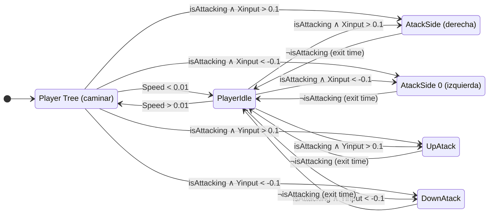
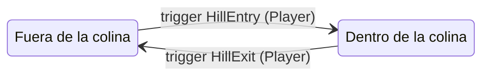

# Proyecto_lenguajes

Videojuego **2D top-down tipo dungeon/Zelda**, con estética **pixel art**, desarrollado en **Unity 6** como proyecto del curso de **Lenguajes de Programación** de la **Unillanos** (Universidad de los Llanos).

El objetivo académico del proyecto es aplicar teoría de **lenguajes formales y autómatas**: el comportamiento del jugador y del mapa se modela mediante autómatas finitos que se documentan en este README.

---

## Descripción del juego

El jugador se mueve en 8 direcciones por un mundo construido con Tilemaps (pasto y colinas), con animaciones direccionales de caminar, idle y ataque. Al entrar en una colina, el mapa cambia su lógica de colisiones para que el jugador pueda recorrerla "por encima" del terreno.

Funcionalidades implementadas:

- Movimiento del jugador con `Rigidbody2D` (8 direcciones).
- Animaciones direccionales: caminar e idle mirando en 4 direcciones, ataque en 4 direcciones.
- Sistema de ataque por clic izquierdo con cooldown y bloqueo de movimiento durante el ataque.
- Zonas de colina con colisiones y orden de renderizado dinámicos.

## Cómo correrlo

1. Instalar **Unity 6.3 LTS**, versión exacta **6000.3.28f1** (recomendado vía Unity Hub).
2. Clonar o descargar este repositorio.
3. En Unity Hub: **Add project from disk** y seleccionar la carpeta raíz del repositorio.
4. Abrir la escena `Assets/Scenes/SampleScene.unity`.
5. Presionar **Play**.

### Controles

| Acción | Entrada |
|--------|---------|
| Mover | Teclas de flechas / ejes `Horizontal` y `Vertical` de Input |
| Atacar | Clic izquierdo del mouse |

---

## Autómatas del proyecto

### 1. FSM del Animator del jugador

**Qué modela:** todo el comportamiento visual del jugador — caminar, quedar en idle y atacar, en cada una de las 4 direcciones.

**Fuente:** `Assets/Animations/Player.controller` (Animator Controller) + scripts `PlayerMovement.cs` y `PlayerAttack.cs`.

**Tipo:** autómata finito determinista (AFD) con condiciones numéricas de guarda. Tiene salidas tanto en los **estados** (cada estado reproduce una animación) como en las **transiciones** (al atacar se congela la velocidad del jugador), lo que lo hace un híbrido entre una máquina de Moore y una de Mealy.

#### Alfabeto de entrada (parámetros del Animator)

| Parámetro | Tipo | Escribe | Significado |
|-----------|------|---------|-------------|
| `Xinput` | float | `PlayerMovement.cs` | Componente X de la última dirección de movimiento (-1 a 1) |
| `Yinput` | float | `PlayerMovement.cs` | Componente Y de la última dirección de movimiento (-1 a 1) |
| `Speed` | float | `PlayerMovement.cs` | Magnitud del movimiento actual |
| `isAttacking` | bool | `PlayerAttack.cs` (true con clic) y `ResetAttack()` vía Animation Event (false al terminar el clip) | Indica que el jugador está atacando |

> Nota: `Xinput`/`Yinput` solo se actualizan **cuando el jugador se mueve**. Al detenerse conservan la última dirección, lo que permite saber en qué dirección atacar aunque el jugador esté quieto.

#### Estados

| Estado | Clip(s) reproducido(s) | Rol |
|--------|------------------------|-----|
| `Player Tree` | BlendTree 2D: `SideWalk` (x=1), `UpWalk` (y=1), `SideWalk` (x=-1), `DownWalk` (y=-1) | Caminar en 4 direcciones |
| `PlayerIdle` | BlendTree 2D: `SideIdle` (x=±1), `Idle` (abajo, y=-1), `UpIdle` (arriba, y=1) | Idle en 4 direcciones |
| `AtackSide` | `AtackSide.anim` | Ataque hacia la derecha |
| `AtackSide 0` | `AtackSide.anim` (mismo clip) | Ataque hacia la izquierda |
| `UpAtack` | `UpAtack.anim` | Ataque hacia arriba |
| `DownAtack` | `DownAtack.anim` | Ataque hacia abajo |

- **Estado inicial:** `Player Tree`.
- El flip izquierdo/derecha lo resuelve el **código** (`spriteRenderer.flipX` en `PlayerMovement.cs`), por eso los clips laterales se comparten entre izquierda y derecha.

#### Tabla de transiciones

Desde `Player Tree`:

| Condición de guarda | Estado destino |
|---------------------|----------------|
| `Speed < 0.01` | `PlayerIdle` |
| `isAttacking == true` ∧ `Xinput > 0.1` | `AtackSide` |
| `isAttacking == true` ∧ `Xinput < -0.1` | `AtackSide 0` |
| `isAttacking == true` ∧ `Yinput > 0.1` | `UpAtack` |
| `isAttacking == true` ∧ `Yinput < -0.1` | `DownAtack` |

Desde `PlayerIdle`:

| Condición de guarda | Estado destino |
|---------------------|----------------|
| `Speed > 0.01` | `Player Tree` |
| `isAttacking == true` ∧ `Yinput > 0.1` | `UpAtack` |
| `isAttacking == true` ∧ `Xinput > 0.1` | `AtackSide` |
| `isAttacking == true` ∧ `Yinput < -0.1` | `DownAtack` |
| `isAttacking == true` ∧ `Xinput < -0.1` | `AtackSide 0` |

Desde cada estado de ataque (`AtackSide`, `AtackSide 0`, `UpAtack`, `DownAtack`):

| Condición de guarda | Estado destino |
|---------------------|----------------|
| `isAttacking == false` (con exit time 0.423 y duración de transición 0.25 s) | `PlayerIdle` |

#### Diagrama de estados



#### El blend tree como generalización del autómata

Los estados `Player Tree` y `PlayerIdle` no son estados con un único clip, sino **blend trees 2D** sobre el par de entradas continuas `(Xinput, Yinput)`. El plano ℝ² queda particionado en regiones de influencia (derecha, izquierda, arriba, abajo) y el autómata "transiciona" de forma suave entre ellas según la dirección. Es la versión continua del AFD clásico: en vez de un símbolo discreto, la entrada es un vector real.

#### Ciclo de vida del ataque (coordinación código ↔ FSM)

1. El jugador hace clic: `PlayerAttack.cs` pone `isAttacking = true` y congela `rb.linearVelocity` (con cooldown de 0.3 s).
2. La FSM toma la dirección de `Xinput`/`Yinput` y entra al estado de ataque correspondiente.
3. Al terminar el clip, una **Animation Event** llama a `ResetAttack()`, que pone `isAttacking = false`.
4. La FSM regresa a `PlayerIdle`.

---

### 2. FSM de las zonas del mapa (colinas)

**Qué modela:** el cambio de reglas del mundo cuando el jugador entra o sale de una colina — qué colisiones están activas y en qué capa de renderizado se dibuja el jugador.

**Fuente:** `HillEntry.cs` y `HillExit.cs`.

**Tipo:** AFD dirigido por eventos físicos (`OnTriggerEnter2D`). No hay estados codificados explícitamente; los estados son las dos configuraciones del mundo que el código mantiene, y las transiciones son los disparadores del tilemap.

#### Alfabeto de entrada

| Evento | Disparado por | Efecto |
|--------|--------------|--------|
| `OnTriggerEnter2D` en la zona de **entrada** a la colina | Tag `Player` | Transición Fuera → Dentro |
| `OnTriggerEnter2D` en la zona de **salida** de la colina | Tag `Player` | Transición Dentro → Fuera |

#### Estados y sus salidas

| Estado | Colliders de colina | Colliders de límites | `sortingOrder` del jugador |
|--------|--------------------:|---------------------:|---------------------------:|
| **Fuera de la colina** | Activados | Desactivados | 5 |
| **Dentro de la colina** | Desactivados | Activados | 15 |

#### Tabla de transiciones

| Estado actual | Entrada | Estado siguiente | Acciones |
|---------------|---------|------------------|----------|
| Fuera | Cruza el trigger `HillEntry` | Dentro | Desactiva colliders de colina, activa límites, `sortingOrder = 15` |
| Dentro | Cruza el trigger `HillExit` | Fuera | Activa colliders de colina, desactiva límites, `sortingOrder = 5` |

**Estado inicial:** Fuera de la colina (configuración por defecto de la escena).

#### Diagrama de estados



Con esta FSM el jugador puede caminar *sobre* la colina sin chocar con ella (los colliders de la colina se desactivan), pero queda contenido dentro del área por los límites, y se dibuja por encima del terreno gracias al `sortingOrder`.

---

## Pendiente / planeado

> **Nota:** lo que sigue **no está implementado** todavía; es el diseño previsto para las próximas iteraciones del proyecto.

- **Autómata finito para los mapas:** FSM que modele el cambio completo de escena/zona al transitar entre mapas (más allá de las colinas actuales).
- **Autómata de pila (PDA) para los mapas:** estructura con memoria de contexto para manejar jerarquías de zonas (p. ej., mundo → dungeon → sala), donde regresar implica desapilar el mapa anterior.
- **Sistema de combos de teclas:** el jugador ejecuta **secuencias de teclas**; si la secuencia coincide con un patrón válido del "diccionario" de combos, se lanza **un proyectil distinto por combo**; si la secuencia no coincide con ningún patrón, **no ocurre nada**. Conceptualmente, un reconocedor de cadenas (trie/AFD sobre el alfabeto de teclas) alimentando una pila de proyectiles (PDA).

---

## Relación con el curso (lenguajes formales y autómatas)

| Elemento del proyecto | Concepto del curso que ilustra |
|-----------------------|-------------------------------|
| FSM del Animator | **Autómata finito determinista (AFD)**: estados, alfabeto de entrada, función de transición por guardas y estado inicial definido. Es además un **híbrido Moore/Mealy**: cada estado produce salida (la animación) y algunas transiciones también tienen acciones (congelar velocidad). |
| Blend trees 2D | **Generalización continua del AFD**: la entrada no es un símbolo discreto sino un vector en ℝ²; el plano se particiona en regiones y la salida interpola entre clips. |
| FSM de zonas (colinas) | **AFD dirigido por eventos** (reconocimiento de eventos físicos del tilemap), con acciones asociadas a cada transición. |
| Ciclo de ataque con Animation Event | Distinción entre **entrada de la FSM** (`isAttacking`) y **acciones de salida** (`ResetAttack()` como evento generado por la animación), y el papel de las **guardas temporales** (cooldown, exit time). |
| Combos de teclas (planeado) | **Reconocimiento de cadenas** sobre un alfabeto: un trie o AFD que acepta exactamente las secuencias válidas, y una **pila** para manejar los proyectiles lanzados — aplicación directa de **AFD y PDA**. |
| Autómatas de mapas (planeado) | AFD para navegación entre zonas y **autómata de pila (PDA)** para la jerarquía de mapas (apilar/desapilar el contexto de ubicación). |

---

## Estructura del proyecto

```
Proyecto_lenguajes/
├── Assets/
│   ├── Animations/          # Clips .anim y Player.controller (la FSM del jugador)
│   ├── Scenes/              # SampleScene.unity (escena principal)
│   ├── Scripts/             # Código C#
│   │   ├── PlayerMovement.cs   # Movimiento y parámetros Xinput/Yinput/Speed
│   │   ├── PlayerAttack.cs     # Activación del ataque (isAttacking) y cooldown
│   │   ├── HillEntry.cs        # Transición a "Dentro de la colina"
│   │   └── HillExit.cs         # Transición a "Fuera de la colina"
│   ├── Sprites/             # Pixel art (jugador, tiles de pasto y colinas)
│   ├── Prefabs/             # Prefabs (vacío por ahora)
│   ├── UI/                  # Interfaz (vacía por ahora)
│   └── Settings/            # Configuración URP y Input System
├── Packages/                # Dependencias (manifest.json)
└── ProjectSettings/         # Configuración del proyecto Unity
```

---

*Proyecto del curso de Lenguajes de Programación — Unillanos.*
